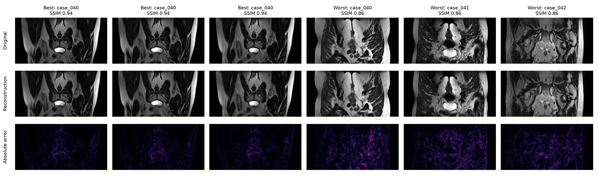
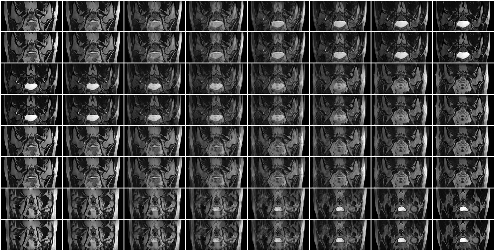
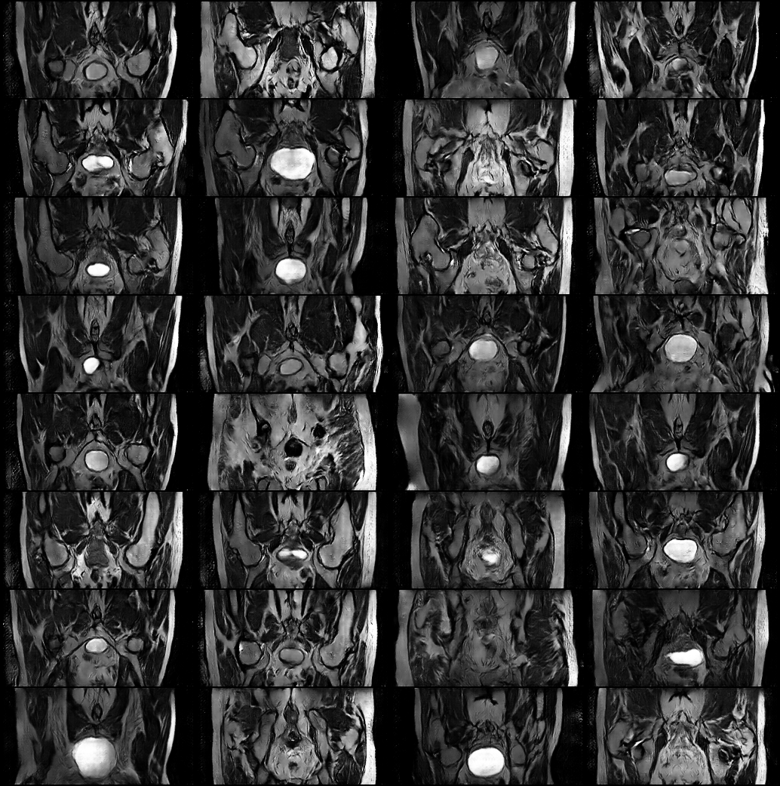
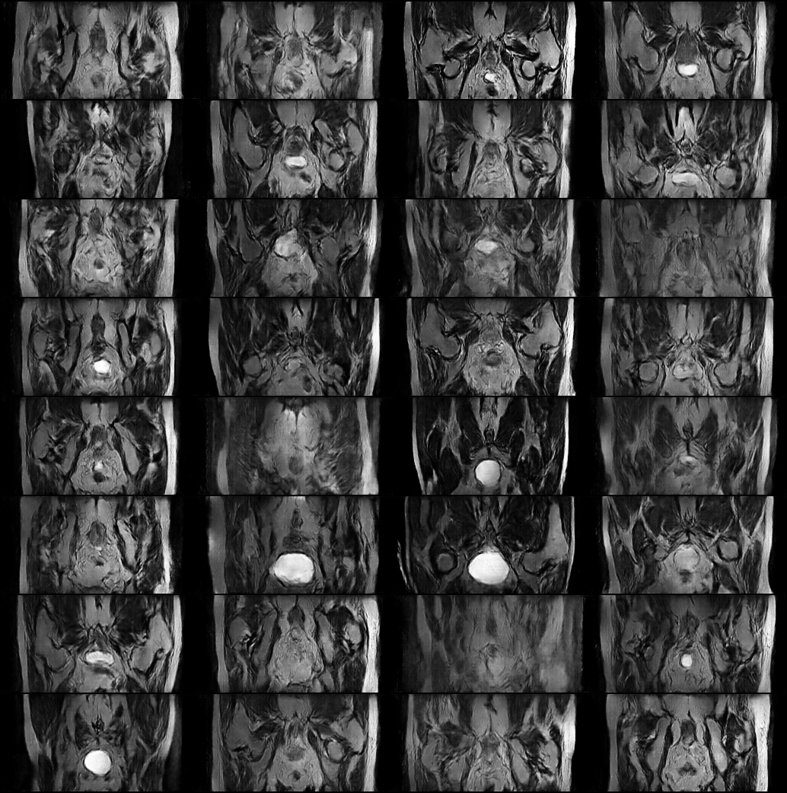
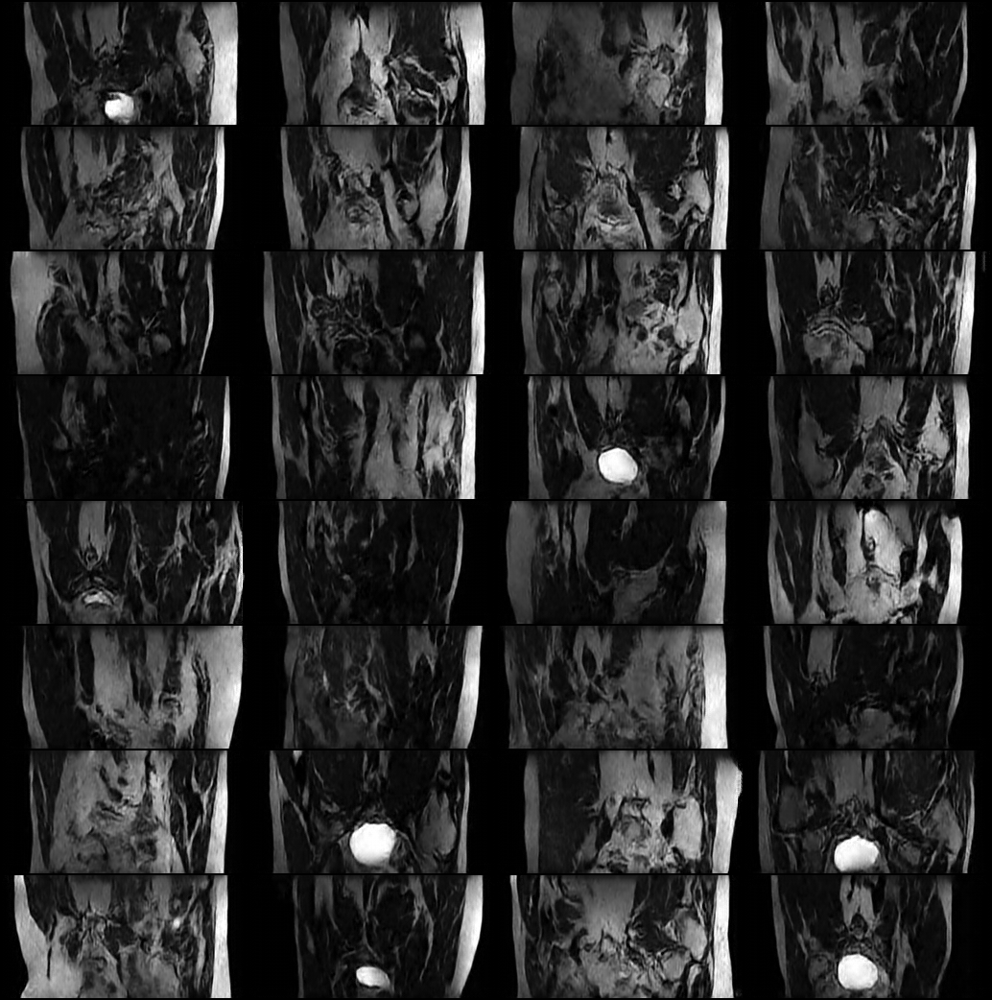
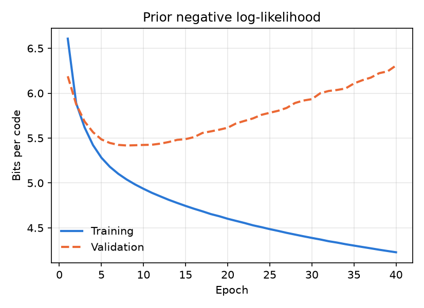

# Synthetic Prostate MRI Slices with a VQ-VAE-2 and PixelCNN Priors (HipMRI)

**Gurkirat Singh Randhawa · s5054910 · COMP3710 Pattern Recognition · Task 2.4 Image Generation · Hard difficulty**

> ✏️ **DRAFT.** Rewrite in your own words before submitting. `TODO` lines wait on the regularised-prior jobs (676473–676478).

## Contents
1. [Problem and algorithm](#1-problem-and-algorithm)
2. [How it works](#2-how-it-works)
3. [Feasibility review](#3-feasibility-review)
4. [Dependencies and reproducibility](#4-dependencies-and-reproducibility)
5. [Usage, example inputs and outputs](#5-usage-example-inputs-and-outputs)
6. [Pre-processing and data splits](#6-pre-processing-and-data-splits)
7. [Open Research Dilemma](#7-open-research-dilemma)
8. [Artificial Intelligence Usage Disclosure](#8-artificial-intelligence-usage-disclosure)
9. [References](#9-references)

## 1. Problem and algorithm

**The problem.** A research group holding the HipMRI prostate study wants a **synthetic cohort**: realistic 2D pelvic MRI slices that it can share between centres, or use for augmentation, without exposing real patients. A useful generator must satisfy three requirements at once:
- **Fidelity:** slices look like real MRI.
- **Diversity:** no mode collapse.
- **Privacy:** it does not reproduce training patients.

**The algorithm.** I use a **VQ-VAE-2** (Razavi et al., 2019), which compresses each 128×256 slice into two grids of discrete codes:
- a coarse **top** grid of 16×32 codes for the overall layout;
- a fine **bottom** grid of 32×64 codes for the detail.

Two **gated PixelCNN** priors (van den Oord et al., 2016) then learn which code grids are plausible. To generate a new slice, the model samples a top grid, then a bottom grid conditioned on it, and decodes both into an image.

**Baselines.** I implemented a single-level **VQ-VAE** (van den Oord et al., 2017) with one prior, plus **DCGAN** and **WGAN-GP** baselines. All four models are trained and evaluated on identical patient-level splits.

**Everything is implemented from scratch in PyTorch:** no pre-built architectures and no pre-trained weights. This includes the SSIM metric, which was validated against scikit-image.

**Result.**

| Measure | Result |
|---|---|
| Reconstruction SSIM | 0.901 on the test set; every test slice > 0.6 |
| Sample fidelity | Best-match SSIM 0.261 against held-out patients. Real unseen patients reach 0.278 |
| Near-copies of training data | 0.3 per 256 samples, against 5.0 for WGAN-GP |
| Sampling speed | 1.48 s per image |


*Figure 1. 32 uncurated VQ-VAE-2 samples (temperature 1.0).*

## 2. How it works


*Figure 2. Training (stages 1–2) and generation (stage 3).*

```
STAGE 1  train autoencoder        STAGE 2  train priors on codes         STAGE 3  generate
image ─► enc_b ─► enc_t ─► top codes 16×32 ──► top PixelCNN p(top)          top PixelCNN ─► top grid
           │         │ dec_t                                                      │ condition
           └─concat──┘                                                            ▼
                ▼                                                           bottom PixelCNN ─► bottom grid
         bottom codes 32×64 ─────► bottom PixelCNN p(bottom | top)                │
                ▼                                                                 ▼
   decoder(up(top) ⊕ bottom) ─► reconstruction (loss: MSE + VQ)             decoder ─► new slice
```

### 2.1 Vector quantisation

Each 64-dimensional encoder vector z_e is replaced by its nearest codebook vector. There are 512 codes per level:

  k = argmin_j ‖z_e − e_j‖²,  z_q = e_k

*Worked example.* z_e = (0.9, 0.1), with codebook e₀ = (1, 0) and e₁ = (0, 1). The squared distances are 0.02 and 1.62, so the vector maps to code 0.

**Loss.**

  L = ‖x − x̂‖² + ‖sg[z_e] − e‖² + β‖z_e − sg[e]‖²,  β = 0.25

| Term | Effect |
|---|---|
| ‖x − x̂‖² | Reconstruction: the output should match the input |
| Codebook term ‖sg[z_e] − e‖² | Moves the codes towards the encoder outputs |
| Commitment term β‖z_e − sg[e]‖² | Keeps the encoder outputs close to their codes |

**Training details.**
- **Straight-through estimator.** argmin has no gradient, so the gradient is copied from the decoder input to the encoder: `z_q = z_e + (z_q − z_e).detach()`.
- **Dead-code restarts** (Dhariwal et al., 2020). Codes that no input selects are moved onto random encoder outputs. This took codebook usage from 3–4 of 512 codes to 510 or more.

### 2.2 Why two levels

In the single-level VQ-VAE, each code covers a 4×4-pixel patch, so the prior must place 2,048 codes one by one with no plan for the global layout. In practice its samples had jumbled anatomy (§7.3, case 1).

VQ-VAE-2 adds a **top level whose codes cover 8×8 pixels**. The top prior decides where the bladder, hips and rectum go first. The bottom level is quantised *with the decoded top level as context*, so its codes only need to add texture and edges.

### 2.3 Gated PixelCNN prior

The prior factorises the distribution of a code grid c in raster order:

  p(c) = ∏ᵢ p(cᵢ | c₁ … cᵢ₋₁)

Each factor is a 512-way softmax.

**Architecture.**
- **12 gated layers,** each with 128 channels, 7×7 kernels and the activation tanh(a)·σ(b).
- **Two stacks.** A **vertical stack** sees the rows above the current position and a **horizontal stack** sees the positions to its left. Together they remove the blind spot of the original PixelCNN.
- **First-layer mask.** The first layer hides the current position, so no prediction sees its own answer.
- **Conditioning.** The bottom prior embeds the top codes, upsamples them 2×, and adds them before every gate.

**Temperature T.** Logits are divided by T before the softmax. *Example:* logits [2, 1, 0] give probabilities [0.67, 0.24, 0.09] at T = 1 and [0.84, 0.11, 0.04] at T = 0.5. Lower T gives more conservative samples.

### 2.4 Baselines

| | DCGAN (Radford et al., 2015) | WGAN-GP (Gulrajani et al., 2017) |
|---|---|---|
| Generator (shared) | z ∈ ℝ¹⁰⁰ → 4×8 block → 5 transposed convs → tanh | same |
| Discriminator / critic | 5 strided convs, batch norm | same layout, **layer norm** (the penalty is computed per sample) |
| Loss | non-saturating BCE | Wasserstein + gradient penalty, λ = 10, n_critic = 5 |
| Optimiser | Adam 2e-4, β = (0.5, 0.999), 100 epochs | Adam 1e-4, β = (0, 0.9), 500 epochs |

## 3. Feasibility review

*Written on 15 Oct 2026, before the prior was trained. It is reproduced unchanged; also available as [`feasibility_review.pdf`](feasibility_review.pdf). How the project measured up against these criteria is in §7.4.*

> **User:** a research group holding the HipMRI prostate study that wants a synthetic cohort it can share across centres and use for augmentation, without exposing real patients.
>
> **Prototype purpose:** decide whether a VQ-VAE with a learned prior produces slices that are anatomically plausible, diverse and *not memorised*.
>
> **Acceptance criteria** (all on the held-out test patients):
> 1. **Fidelity:** mean paired SSIM > 0.6 between test slices and their VQ-VAE reconstructions.
> 2. **No memorisation:** generated slices sit no closer to the training set than unseen real patients do. That is, mean best-match SSIM to training ≤ the real test mean (0.301), and ≤ 5% of samples above the real maximum (0.407).
> 3. **Diversity:** mean pairwise SSIM between generated samples ≤ that between real test slices (no mode collapse).
> 4. **Comparison:** on criteria 2–3, the VQ-VAE matches or beats both GAN baselines under identical splits.
> 5. **Resources:** each model trains in ≤ 2 h on one A100 at ≤ 8 GB peak VRAM; generation ≤ 1 s per slice.
>
> **Model choice:**
> - **Model:** VQ-VAE with a convolutional encoder (4× downsampling to a 32 × 64 grid), a 512 × 64 codebook with straight-through gradients and β = 0.25, dead-code restarts, and a mirrored decoder. A PixelCNN prior over the code grids then samples new slices.
> - **Baselines:** DCGAN and WGAN-GP, sharing one generator.
> - **Rationale:** it builds on the course's autoencoder and GAN material. Training is likelihood-based, with no adversarial game. The discrete latent makes the prior tractable, and reconstruction gives a directly measurable *paired* SSIM.
>
> **Preliminary evidence:**
> - **Data audit:** 12,660 slices from 38 patients. The provided split is 31 / 4 / 3 patients, with zero patient overlap.
> - **DCGAN:** 14 min, 1.88 GB. Best-match SSIM to training 0.266, against 0.301 for real test slices.
> - **WGAN-GP:** about 2 h, 2.54 GB. It matches real on average but has a maximum of 0.489 against a real maximum of 0.407 (some near-copies).
> - **Key finding:** real unseen patients reach only about 0.30 best-match SSIM against the training set, so SSIM > 0.6 is unreachable for unpaired samples without copying. The 0.6 target is therefore applied to paired reconstructions.
> - **VQ-VAE smoke test:** 690,753 parameters. 3–4 codes were used before restarts and 505+ after.
>
> **Risks and fallback:**
> - **Codebook collapse:** mitigated by restarts; EMA updates are the fallback.
> - **A slow or incoherent PixelCNN:** fall back to a coarser 16 × 32 grid.
> - **The prior reproduces training grids:** tested directly by criterion 2.
> - **Queue delays:** no new models after 21 October.
> - **Budget:** under 15 A100-hours in total.
> - **Fallback:** WGAN-GP (Normal band) with the full audit.
> - **Question for the tutor:** how should SSIM > 0.6 be measured for unpaired samples?

## 4. Dependencies and reproducibility

| Package | Version |
|---|---|
| Python | 3.11 |
| PyTorch | 2.13.0+cu130 |
| torchvision | 0.28.0 |
| numpy | TODO |
| nibabel | TODO |
| matplotlib | TODO |
| tqdm | TODO |
| scikit-image | TODO (only to cross-check the SSIM implementation) |

Install with `pip install -r requirements.txt`, which was generated by `pip freeze` in the Rangpur `torch` environment. Hardware: one NVIDIA A100 (Rangpur `comp3710` partition).

**Reproducibility.**
- **Fixed seeds.** Every script has a fixed `--seed`: 42 for training, 0, 1 and 2 for sampling.
- **Fixed splits.** The splits are the provided patient folders, checked for leakage at load time.
- **Repeated sampling.** Every generator is sampled with **3 seeds × 256 samples**, and results are reported as mean ± std, so a single lucky run cannot drive a conclusion.
- **Checkpoint selection.** Checkpoints are chosen on the validation set only.
- **Remaining variation.** GPU kernels are not fully deterministic, so re-runs can differ slightly. For example, the near-copy count for one setting ranged over 0–3 across seeds, which is why it is reported with its std.
- **Weights.** Trained weights are not committed. The commands in §5 recreate them in about 1 A100-hour for the recommended model.

## 5. Usage, example inputs and outputs

```
dataset.py       loading, transpose, centre-crop, normalisation, patient-leakage check
modules.py       DCGAN, WGAN-GP critic, VQ-VAE, VQ-VAE-2, gated PixelCNN
metrics.py       batched GPU SSIM: paired, best-match, pairwise
train.py         training driver  (--model dcgan | wgan_gp | vqvae | vqvae2 | pixelcnn)
predict.py       evaluation driver (reconstruction, sampling + audit, interpolation)
slurm_train.sh   Rangpur job script for train.py
slurm_predict.sh Rangpur job script for predict.py
```

**Train and evaluate the recommended model** (run on Rangpur from this folder; outputs go to `~/hipmri_runs/<run>/`):

```bash
python3 dataset.py                       # data audit + leakage check
python3 modules.py                       # shape and parameter-count check

sbatch slurm_train.sh --model vqvae2 --epochs 100
sbatch slurm_train.sh --model pixelcnn --level top    --vqvae-weights ~/hipmri_runs/vqvae2/vqvae2.pt --run-name pixelcnn2_top
sbatch slurm_train.sh --model pixelcnn --level bottom --vqvae-weights ~/hipmri_runs/vqvae2/vqvae2.pt --run-name pixelcnn2

sbatch slurm_predict.sh --model vqvae2                                    # reconstruction SSIM on test
sbatch slurm_predict.sh --model vqvae2 --interpolate                      # latent interpolation
sbatch slurm_predict.sh --model pixelcnn2 --repeats 3 --temperature 1.0   # samples + audit
```

Baselines: `--model dcgan --epochs 100` and `--model wgan_gp --epochs 500`, then `predict.py --model dcgan|wgan_gp --repeats 3`.

**Example 1: reconstruction.**
- **Input:** a test slice (1×128×256, in [0, 1]).
- **Output:** its reconstruction, plus the absolute error map.
- **Log line:** `Reconstruction SSIM on 540 test slices: mean 0.901, std 0.018, min 0.858, max 0.939, 100% above 0.6`


*Figure 3. Best and worst VQ-VAE-2 test reconstructions (top: input, middle: output, bottom: |error|).*

**Example 2: generation.**
- **Input:** none (a random seed).
- **Output:** new slices, plus an audit of each sample against the training and held-out sets.


*Figure 4. Generated samples (top) and their closest training slices (bottom). The samples are new slices, not copies.*

**Example 3: interpolation** between two real test slices.


*Figure 5. VQ-VAE-2 latent interpolation, 4 paths × 8 frames.*

## 6. Pre-processing and data splits

**Data:** `HipMRI_Study_open/keras_slices_data`, 12,660 2D NIfTI slices from 38 patients. Only the images are used; the segmentation masks are not.

| Step | What | Why |
|---|---|---|
| Transpose | 256×128 → 1×128×256 | Puts the slice in its natural landscape orientation |
| Centre-crop | The 60 slices of 256×144 lose 8 rows top and bottom | Gives every slice the same shape. Staff confirmed on Ed (#177) that these slices may be discarded. Cropping keeps them instead, and the removed rows are background |
| Per-slice normalisation | Clip at the 99.5th percentile, then scale to [0, 1] (GANs: [−1, 1] for tanh) | Raw intensity scales differ between scans (e.g. 0–411). Clipping stops a few bright pixels compressing the useful range. Per-slice scaling removes scanner-dependent intensity offsets |

**Splits:** the provided train / validate / test folders.

| Split | Patients | Slices | Used for |
|---|---|---|---|
| Train | 31 | 11,460 | Fitting all models |
| Validate | 4 | 660 | Checkpoint selection (best validation SSIM or bits per code) |
| Test | 3 | 540 | Final reconstruction numbers only |

**Why these splits are justified:**
- **Split by patient.** Neighbouring slices from one patient are almost identical. A random slice-level split would put near-duplicates in both the training and test sets, inflating every score and hiding memorisation. `check_no_patient_leakage()` confirms **zero patient overlap**.
- **One split for every model.** All models use the same split, so the comparison is like-for-like.
- **Generation reference set.** For the generation audit, the held-out reference is **test + validation (7 patients)**. Three patients proved too small a reference: their pairwise SSIM was inflated to 0.193, against 0.161 with 7 patients.

## 7. Open Research Dilemma

**The question:** does a likelihood-based discrete-latent model (VQ-VAE-2 + PixelCNN) beat adversarial baselines at generating *realistic but non-memorised* MRI, and at what cost?

### Evaluation protocol

SSIM follows Wang et al. (2004): an 11×11 Gaussian window with σ = 1.5. A generated slice has no paired original, and even **real held-out patients reach only 0.278** best-match SSIM against the training set. So the > 0.6 target is applied to *paired reconstructions*, and generated samples are judged against that real-patient reference:

| Metric | Meaning | Target |
|---|---|---|
| Reconstruction SSIM | Autoencoder(x) vs x, on test | > 0.6 |
| Best-match SSIM vs held-out | Each sample's closest held-out real slice | Close to the real value, 0.278 |
| Near-copies | Samples closer to a training slice than any held-out real slice ever is (> 0.407) | ≈ 0 |
| Pairwise SSIM | Mean SSIM between samples (diversity) | Close to the real value, 0.161 |
| Coarse pairwise SSIM | The same after 4× average pooling: compares layouts, ignores texture | Close to the real value, 0.125 |

### 7.1 Quantitative benchmark (identical splits, 3 seeds × 256 samples)

| Model | Reconstruction SSIM | vs held-out ↑ | vs train | Near-copies /256 ↓ | Pairwise | Coarse |
|---|---|---|---|---|---|---|
| *Real held-out slices* | — | — | *0.278* | — | *0.161* | *0.125* |
| DCGAN | — | 0.223 ± 0.002 | 0.271 | 1.7 ± 1.2 | 0.155 | 0.113 |
| WGAN-GP | — | 0.244 ± 0.001 | 0.297 | 5.0 ± 2.0 | 0.174 | 0.140 |
| VQ-VAE + prior, T = 1.0 | **0.906** | 0.242 ± 0.000 | 0.267 | 0.3 ± 0.6 | 0.181 | 0.086 |
| VQ-VAE + prior, T = 0.9 | 0.906 | 0.263 ± 0.001 | 0.294 | 1.3 ± 1.5 | 0.223 | 0.096 |
| VQ-VAE + prior, T = 0.8 | 0.906 | 0.279 ± 0.003 | 0.317 | 3.3 ± 2.1 | 0.273 | 0.111 |
| **VQ-VAE-2, T = 1.0** | 0.901 | **0.261 ± 0.002** | 0.292 | **0.3 ± 0.6** | 0.210 | 0.145 |
| VQ-VAE-2, T = 0.95 | 0.901 | TODO | | | | |
| VQ-VAE-2, T = 0.9 | 0.901 | 0.279 ± 0.004 | 0.315 | 3.3 ± 1.2 | 0.247 | 0.169 |
| VQ-VAE-2, regularised priors | 0.901 | TODO | | | | |

**Findings:**
- **Fidelity and privacy.** At T = 1.0, VQ-VAE-2 has the highest fidelity and ties for the fewest near-copies. WGAN-GP comes close on fidelity (0.244) but makes about 17× more near-copies.
- **Temperature is a dial, not a free gain.** T = 0.9 reaches the real reference (0.279), but near-copies rise about 10× and diversity falls.
- **Lower coarse SSIM is not automatically better.** The single-level VQ-VAE (0.086) is *more* varied than real data because its layouts are jumbled. VQ-VAE-2 (0.145) is slightly *less* varied because it favours typical layouts.

| DCGAN | WGAN-GP | VQ-VAE (T = 0.9) | VQ-VAE-2 (T = 1.0) |
|---|---|---|---|
|  |  |  |  |

*Figure 6. Uncurated samples from each model.*

**Interpolation (consecutive-frame SSIM, 4 paths × 8 frames):**

| Model | Mean | Min | Pixel cross-fade (mean / min) |
|---|---|---|---|
| DCGAN | 0.690 | 0.449 | 0.941 / 0.883 |
| WGAN-GP | 0.778 | 0.585 | 0.950 / 0.861 |
| VQ-VAE | 0.903 | 0.888 | 0.952 / 0.914 |
| VQ-VAE-2 | 0.936 | 0.894 | 0.951 / 0.912 |

- **GANs:** the paths are coherent but jumpy.
- **VQ-VAE models:** the paths are smooth but resemble a cross-fade, because the latent is spatial.

### 7.2 Resource profiling (one A100)

| Model | Parameters | Peak VRAM (training) | Training time | Inference latency |
|---|---|---|---|---|
| DCGAN (G + D) | 14.4 M + 11.2 M | 1.88 GB | ~14 min (100 epochs) | **0.17 ms / sample** |
| WGAN-GP (G + critic) | 14.4 M + 11.2 M | 2.54 GB | ~2 h (500 epochs) | **0.17 ms / sample** |
| VQ-VAE | 690,753 | 1.27 GB | ~9 min (100 epochs) | 0.28 ms / reconstruction |
| + PixelCNN prior (regularised) | 13,724,800 | 4.46 GB | ~32 min (40 epochs) | 1.11 s / sample |
| VQ-VAE-2 | 1,653,889 | 1.62 GB | ~12 min (100 epochs) | 0.35 ms / reconstruction |
| + top prior | 13,724,800 | 2.69 GB | ~10 min | } 1.48 s / sample |
| + bottom prior (conditioned) | 15,009,024 | 4.66 GB | ~37 min | } (both priors + decoder) |
| + regularised priors | same | TODO | TODO | TODO |

**Latency** is measured over 256 samples at batch 256, including decoding. PixelCNN sampling needs one network pass per code position: 512 + 2,048 positions for VQ-VAE-2. That makes it compute-bound, and larger batches did not reduce the time per sample.

### 7.3 Error autopsies

**Case 1. Jumbled global anatomy (single-level prior).**
- **Failure mode:** samples had realistic local texture but no coherent pelvis. Hip joints were missing, the bladder was often in the left third of the image, and there were occasionally two bladders.
- **Root trigger:** the prior samples 2,048 codes in raster order, and each code covers only 4×4 px. Early rows are committed before anything decides where later anatomy should go.
- **Action:** VQ-VAE-2's 8×8-px top level plans the layout first. Bladders are now centred in about half the samples, against about 7/32 before, and hips are visible. **Mostly fixed.**

| Single-level VQ-VAE | VQ-VAE-2 |
|---|---|
|  |  |

**Case 2. Prior overfitting.**
- **Failure mode:** the validation loss bottoms out early and then rises. At epoch 60 the unregularised prior was at 3.72 bits/code on train and 6.44 on validation. The bottom prior is best at around epoch 8.
- **Root trigger:** only 31 training patients, with near-duplicate neighbouring slices.
- **Action:** keep the best-validation checkpoint, and add dropout 0.3 and AdamW weight decay 0.01 (Loshchilov & Hutter, 2019). These improved the best validation loss from 5.148 to 5.089 bits but did not close the gap. TODO: the VQ-VAE-2 regularised result.



**Case 3. WGAN-GP near-copies.**
- **Failure mode:** about 5 of 256 samples are closer to a specific training slice (up to 0.456) than any real new patient ever gets (0.407).
- **Root trigger:** the critic is only loosely constrained (the gradient-penalty term is about 2), and nothing in the GAN objective penalises reproducing a training example. The Wasserstein estimate also *rose* from 40 to 62 while the images improved, so it gave no warning.
- **Lesson:** a good mean hides leaky tails. Audit the maximum, not just the average.


**Case 4. Smoothed reconstructions of textured slices.**
- **Failure mode:** the worst test reconstructions (SSIM about 0.86) are slices with fine high-contrast texture, such as muscle striations and bowel gas. The error is spread along fine edges.
- **Root trigger:** each bottom code covers 4×4 px, and the MSE loss favours blurry averages.
- **Action (future work):** add a perceptual or SSIM loss term, or use a finer grid.

**Case 5. Bland samples at low temperature.**
- **Failure mode:** at T = 0.8–0.9, fidelity reaches the real reference, but several samples are washed-out or nearly featureless, and near-copies rise about 10×.
- **Root trigger:** sharpening the softmax concentrates sampling on the most frequent codes, which encode homogeneous tissue.
- **Lesson:** a higher mean SSIM can come with less useful samples.

### 7.4 Outcome against the feasibility criteria

| Criterion | Outcome | Met? |
|---|---|---|
| 1. Reconstruction SSIM > 0.6 | 0.901; every test slice > 0.6 | ✅ |
| 2. No memorisation | vs train 0.292 vs real 0.278 (slightly above); 0.1 % near-copies (≤ 5 %) | ⚠️ / ✅ |
| 3. Diversity: pairwise ≤ real | 0.210 vs 0.161. Less varied than real, but no mode collapse | ❌ |
| 4. Beats both GANs | Best fidelity, fewest near-copies | ✅ |
| 5. Resources | Training and VRAM within budget; sampling 1.48 s > 1 s | ⚠️ |

### 7.5 Recommendation for the project manager

**Ship VQ-VAE-2 + priors at T = 1.0 as the synthetic-cohort generator.**
- **Fidelity:** it is the most realistic of the T = 1.0 generators.
- **Privacy:** it is the least likely to leak a training patient, which matters most for a cohort shared between centres.
- **Anatomy:** its layout is clearly better than the single-level model's.
- **Cost of generation:** at 1.48 s per slice, a 10,000-slice cohort takes about 4 GPU-hours. That is acceptable for a one-off release.

| If the priority is… | Choose | Trade-off |
|---|---|---|
| Privacy + anatomy (default) | VQ-VAE-2, T = 1.0 | Slow sampling; layouts slightly less varied than real |
| Maximum average realism | VQ-VAE-2, T = 0.9 | ~10× more near-copies, blander samples |
| On-the-fly augmentation during training | WGAN-GP | 8,700× faster, but 5/256 near-copies; run the near-copy audit before any release |

**Before release, always:**
- run the near-copy audit and drop any sample above the real-patient maximum;
- have a radiologist review a random subset.

**Next steps, by value:**
1. A faster prior (transformer with KV caching, or MaskGIT-style parallel decoding) to meet the 1 s target.
2. A perceptual loss for sharper texture.
3. 3D, volume-consistent generation.
4. A domain-appropriate perceptual metric. FID's ImageNet features suit MRI poorly.

## 8. Artificial Intelligence Usage Disclosure

TODO, **in your own words**, following Section 6 of the specification:
- **Tool:** which tool you used (Claude).
- **Purpose:** what you used it for, e.g. explaining concepts, drafting and debugging code, structuring this README.
- **Your own contribution:** what you decided and did yourself.
- **Verification:** how you checked its output, e.g. validating SSIM against scikit-image, running every experiment on Rangpur yourself, and catching wrong estimates such as the near-copy count and the batching speed-up.
- **Evidence:** a link to the conversation or a `prompt_history.pdf`.

## 9. References

- Dhariwal, P. et al. (2020). Jukebox: A generative model for music. *arXiv:2005.00341*.
- Gulrajani, I. et al. (2017). Improved training of Wasserstein GANs. *NeurIPS*.
- Loshchilov, I. & Hutter, F. (2019). Decoupled weight decay regularization. *ICLR*.
- Radford, A., Metz, L. & Chintala, S. (2015). Unsupervised representation learning with deep convolutional GANs. *arXiv:1511.06434*.
- Razavi, A., van den Oord, A. & Vinyals, O. (2019). Generating diverse high-fidelity images with VQ-VAE-2. *NeurIPS*.
- van den Oord, A. et al. (2016). Conditional image generation with PixelCNN decoders. *NeurIPS*.
- van den Oord, A., Vinyals, O. & Kavukcuoglu, K. (2017). Neural discrete representation learning. *NeurIPS*.
- Wang, Z. et al. (2004). Image quality assessment: From error visibility to structural similarity. *IEEE TIP*, 13(4).
