# Synthetic Prostate MRI Slices with VQ-VAE-2 and PixelCNN Priors (HipMRI)

**Gurkirat Singh Randhawa · 50549102 · COMP3710 Pattern Recognition and Analysis · Task 2.4 Image Generation · Hard difficulty**

## Contents
1. [Problem and algorithm](#1-problem-and-algorithm)
2. [How it works](#2-how-it-works)
3. [Feasibility review](#3-feasibility-review)
4. [Dependencies and reproducibility](#4-dependencies-and-reproducibility)
5. [Usage, file structure, example inputs and outputs](#5-usage-file-structure-example-inputs-and-outputs)
6. [Pre-processing and data splits](#6-pre-processing-and-data-splits)
7. [Open Research Dilemma](#7-open-research-dilemma)
8. [Discussion and conclusion](#8-discussion-and-conclusion)
9. [Artificial Intelligence Usage Disclosure](#9-artificial-intelligence-usage-disclosure)
10. [References](#10-references)

## 1. Problem and algorithm

**The problem.** A research group holding the HipMRI prostate study wants a **synthetic cohort**: realistic 2D pelvic MRI slices that it can share between centres or use for augmentation, **without exposing real patients**. A useful generator has to meet three goals at once:
- **Realism:** slices look like real MRI.
- **Diversity:** no mode collapse.
- **Privacy:** no copying of training patients.

**The algorithm.** A **VQ-VAE-2** (Razavi et al., 2019) compresses each 128×256 slice into two grids of discrete codes:
- a coarse **top grid** (16×32) for the overall anatomy;
- a fine **bottom grid** (32×64) for texture.

Two **gated PixelCNN priors** (van den Oord et al., 2016) learn which code grids are plausible. A new slice is made by sampling a top grid, then a bottom grid conditioned on it, and decoding both.

**Baselines.** The model is benchmarked on identical patient-level splits against a single-level **VQ-VAE** (van den Oord et al., 2017) and two GANs, **DCGAN** and **WGAN-GP**. The two strongest families, DCGAN and VQ-VAE-2, are also trained with left-right flip augmentation as an ablation.

**Everything is implemented from scratch in PyTorch:** all models, the PixelCNN and the SSIM, FID and KID code. No pre-trained weights are used anywhere except the standard Inception-v3 inside FID, which is used only to *measure* images.

**Headline results** (test patients, scored once after all choices were made on validation):

| | VQ-VAE-2 + aug, top-k 32 (Hard model, selected) | VQ-VAE-2 + aug, full sampling T = 0.9 | DCGAN + aug (best baseline) |
|---|---|---|---|
| Reconstruction SSIM (target > 0.6) | **0.919**, 100 % of slices > 0.6 | **0.919** (same autoencoder) | — (no encoder) |
| FID / KID×1000 (real floor 50.9 / 10.1) | 117.8 / 91.8 | 127.0 / 112.5 | **86.1 / 51.0** |
| Near-copies of training slices | 0.7 % | **0.4 %** | **0.4 %** |
| Diversity, pairwise SSIM (real 0.193; lower = more varied) | 0.245 (less varied than real) | 0.176 | 0.161 |
| Sampling time per slice | 1.50 s | 1.48 s | 0.18 ms |

Truncated (top-k) sampling is the best VQ result, but it buys quality by giving up diversity; full sampling is the VQ setting that meets every criterion except quality. Section 7.2 and Case 5 in Section 7.6 explain why.

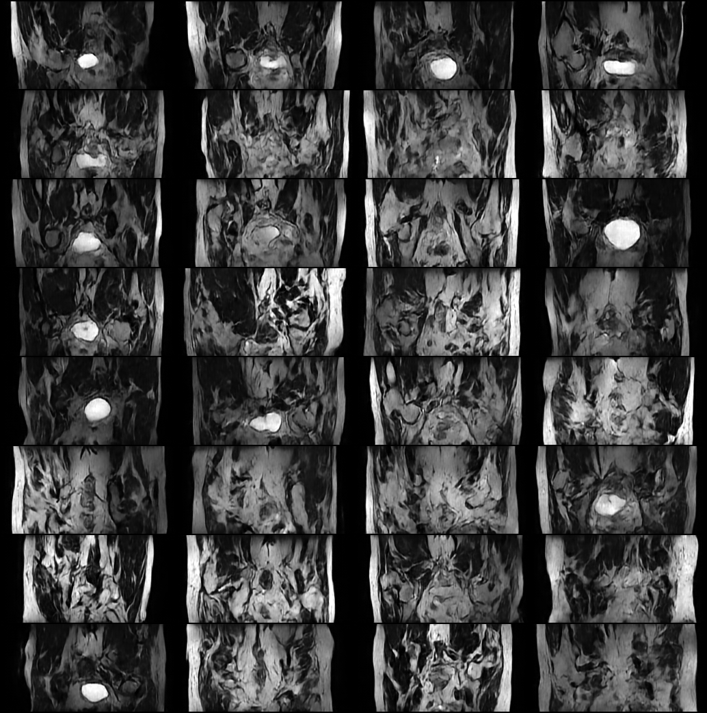
*Figure 1. 32 uncurated VQ-VAE-2 + aug samples at temperature 0.9 (test run, seed 0).*

## 2. How it works

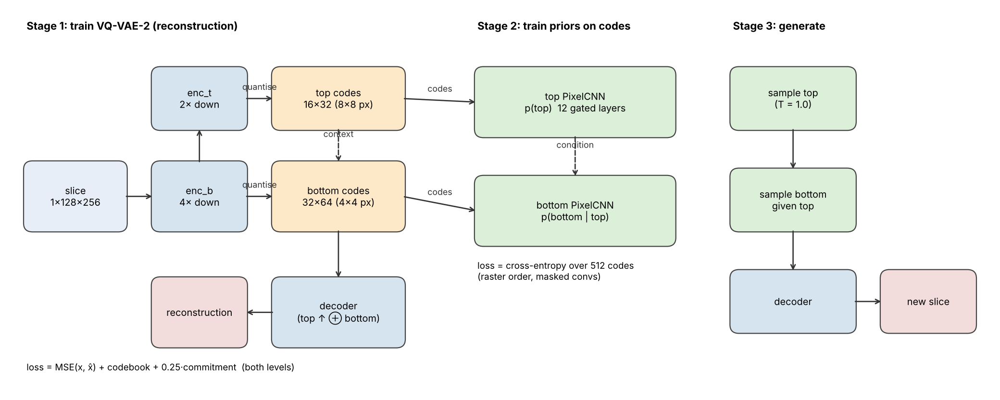
*Figure 2. Stage 1 trains the autoencoder, stage 2 trains the priors on its codes, and stage 3 generates new slices.*

### 2.1 Vector quantisation

The encoder turns an image into a grid of 64-dimensional vectors z_e. Each vector is replaced by its nearest entry in a codebook of 512 learned vectors:

  k = argmin_j ‖z_e − e_j‖²,  z_q = e_k

*Worked example.* Take z_e = (0.9, 0.1) and a codebook e₀ = (1, 0), e₁ = (0, 1). The squared distances are 0.02 and 1.62, so the vector becomes code 0.

**Loss** (sg = stop-gradient, β = 0.25):

  L = ‖x − x̂‖² + ‖sg[z_e] − e‖² + β‖z_e − sg[e]‖²

| Term | Effect |
|---|---|
| ‖x − x̂‖² | Reconstruction: the output should match the input |
| ‖sg[z_e] − e‖² | Moves the codes towards the encoder outputs |
| β‖z_e − sg[e]‖² | Keeps the encoder outputs close to their codes |

- **Straight-through estimator.** argmin has no gradient, so the decoder's gradient is copied to the encoder: `z_q = z_e + (z_q − z_e).detach()`.
- **Dead-code restarts** (Dhariwal et al., 2020). Codes that no input selects are moved onto recent encoder outputs. This raised usage from 3–4 of 512 codes to 507–512.

### 2.2 Why two levels

In a single-level VQ-VAE each code covers a 4×4-pixel patch, so the prior places 2,048 codes one by one with no plan for the global layout. In practice its samples had realistic texture but jumbled anatomy (Section 7.6, Case 1).

VQ-VAE-2 adds a **top level whose codes each cover 8×8 pixels**. The top prior decides where the bladder, hips and rectum go first. The bottom level is quantised *with the decoded top level as context*, so its codes only need to add detail. This one change improves FID by about 45 at every temperature (Section 7.2).

### 2.3 Gated PixelCNN prior

The prior factorises the distribution of a code grid c in raster order (left to right, top to bottom):

  p(c) = ∏ᵢ p(cᵢ | c₁ … cᵢ₋₁)

Each factor is a 512-way softmax.

- **Network:** 12 gated layers with 128 channels, 7×7 kernels and gate tanh(a)·σ(b).
- **Two stacks:** a **vertical stack** sees the rows above and a **horizontal stack** sees the positions to the left. Together they remove the original PixelCNN's blind spot.
- **First-layer mask:** hides the current position, so no prediction sees its own answer. A test proves this (`tests/test_pixelcnn_causality.py`).
- **Conditioning:** the bottom prior embeds the top codes, upsamples them 2× and adds them before every gate.

**Temperature T.** Logits are divided by T before the softmax. *Example:* logits [2, 1, 0] give probabilities [0.67, 0.24, 0.09] at T = 1 and [0.87, 0.12, 0.02] at T = 0.5. Lower T gives safer, less varied samples.

### 2.4 Baselines

| | DCGAN (Radford et al., 2015) | WGAN-GP (Gulrajani et al., 2017) |
|---|---|---|
| Generator (shared) | z ∈ ℝ¹⁰⁰ → 4×8 block → 5 transposed convs → tanh | same |
| Discriminator / critic | 5 strided convs with batch norm | same layout with **layer norm** (the penalty is computed per sample) |
| Loss | non-saturating BCE | Wasserstein loss + gradient penalty, λ = 10, n_critic = 5 |
| Optimiser | Adam 2e-4, β = (0.5, 0.999), 100 epochs | Adam 1e-4, β = (0, 0.9), 500 epochs |

### 2.5 Hyperparameters and their justification

| Setting | Value | Why |
|---|---|---|
| Codebook | 512 codes × 64 dims per level | Large enough that 507–512 codes are used (perplexity ≈ 330), with no collapse |
| Commitment β | 0.25 | Value from the VQ-VAE paper; reconstruction was stable |
| Autoencoder optimiser | Adam 2e-4, batch 64, 100 epochs, best validation SSIM kept | Validation SSIM was still rising slowly at epoch 100 |
| Prior | 12 layers, 128 channels, 7×7 kernels | Receptive field covers most of a 32×64 grid within GPU memory |
| Prior regularisation | dropout 0.3, AdamW weight decay 0.01 | The prior overfits 31 patients within a few epochs (Section 7.4) |
| Prior batch | 32 | Keeps peak memory under the 8 GB budget (4.7 GB) |
| Early stopping | patience 10 on validation loss/SSIM | Stops once validation stops improving; the best epoch is kept |
| Gradient clipping | norm 1.0 (priors) | Stops one unusual batch from destabilising PixelCNN training |
| Augmentation | random left-right flip (training only) | Pelvic MRI is roughly symmetric; it doubles the data for a small cohort |
| Sampling | 3 seeds × 256 samples | Gives mean ± std, so single lucky runs don't decide anything |

## 3. Feasibility review

*One-page review, also available as [`feasibility_review.pdf`](feasibility_review.pdf).*

> **Gurkirat Singh Randhawa (50549102)** · COMP3710 · Domain 2.4 Image Generation · Hard difficulty · October 2026
>
> **Open dilemma:** can a generative model produce prostate MRI slices that are realistic and diverse **without memorising** the training patients?
>
> **1. User need, scope and acceptance criteria**
>
> **Intended user:** a research group holding the HipMRI study that wants a synthetic cohort it can share or use for augmentation without exposing real patients. **Prototype purpose:** test whether a VQ-VAE-2 with learned priors meets that need, and how it compares with GAN baselines. **Scope:** unconditional 2D slices (256×128), no segmentation labels.
>
> 1. **Fidelity:** mean SSIM > 0.6 between test slices and their reconstructions.
> 2. **Quality:** FID / KID against unseen patients, reported next to a real-data floor and the DCGAN / WGAN-GP baselines.
> 3. **No memorisation:** ≤ 5 % of samples are *near-copies* (closer to a training slice than any real unseen slice is).
> 4. **Diversity:** pairwise SSIM between samples no higher than between real slices (no mode collapse).
> 5. **Resource constraint:** ≤ 2 h training per model and ≤ 8 GB peak VRAM on one A100.
>
> **2. Model choice and course concepts**
>
> - **Dataset configuration:** HipMRI 2D slices, 12,660 slices from 38 patients, split **31 / 4 / 3 by patient** (no leakage). Settings are chosen on validation; test is used once.
> - **Model (Hard band):** VQ-VAE-2 encodes each slice into two grids of discrete codes: a 16×32 top grid for layout and a 32×64 bottom grid for detail, each with a 512-entry codebook. Two gated PixelCNN priors learn the code grids; sampling the priors and decoding gives new slices.
> - **Course concepts:** convolutional autoencoders, vector quantisation, autoregressive models (masked convolutions), GANs, and regularisation (dropout, weight decay, early stopping, augmentation).
> - **Literature:** VQ-VAE (van den Oord et al., 2017); VQ-VAE-2 (Razavi et al., 2019); gated PixelCNN (van den Oord et al., 2016); DCGAN (Radford et al., 2016); WGAN-GP (Gulrajani et al., 2017); FID (Heusel et al., 2017). The two-level design targets the known weakness of single-level priors: correct texture but incoherent global anatomy.
>
> **3. Preliminary feasibility evidence**
>
> - **Data audit:** all 38 patients load; zero patient overlap between splits (checked in code).
> - **Reconstruction:** test SSIM **0.92** (every slice > 0.6) with 507 / 512 codes in use. **Criterion 1 met.**
> - **Smoke test of generation:** the two-level model is about 45 FID better than a single-level VQ-VAE, with visibly coherent anatomy.
> - **Memorisation:** about 1 % near-copies for VQ-VAE-2, against 9.4 % for WGAN-GP.
> - **Measured resources:** every model trains in under 2 h at ≤ 4.7 GB VRAM. **Criterion 5 met.**
>
> **4. Risks, budget and fallback**
>
> | Risk | Mitigation |
> |---|---|
> | Prior overfits 31 patients | Dropout, weight decay, left-right flip augmentation, early stopping, best checkpoint |
> | Sampling is slow (about 1.5 s per slice) | Accept for offline cohort generation; a faster prior is future work |
> | A GAN baseline scores better FID | Report honestly; recommend a model per use case |
> | Codebook collapse | Dead-code restarts; monitor codes used |
>
> **Computing budget:** about 15 A100 GPU-hours on Rangpur in total; only best checkpoints are kept.\
> **Next planned experiment:** one-off test-set benchmark of the selected configurations (3 seeds × 256 samples).\
> **Fallback:** WGAN-GP or DCGAN with the same evaluation (Normal band).

The final outcome against each criterion is in Section 7.7.

## 4. Dependencies and reproducibility

| Package | Version | Used for |
|---|---|---|
| Python | 3.11.15 | |
| PyTorch | 2.13.0 (+cu130) | models and training |
| torchvision | 0.28.0 | image grids |
| numpy | 2.4.6 | arrays |
| nibabel | 5.4.2 | reading NIfTI slices |
| matplotlib | 3.11.2 | figures |
| tqdm | 4.70.1 | progress bars |
| pillow | 12.3.0 | image saving |
| pytorch-fid | 0.3.0 | Inception-v3 weights for FID/KID only |
| scikit-image, scipy | 0.26.0, 1.17.1 | tests that check SSIM and FID against reference implementations |
| pytest | 9.1.1 | running `tests/` |

Install PyTorch for your CUDA version first, then:
```bash
pip install -r requirements.txt
pip install --no-deps pytorch-fid==0.3.0   # --no-deps keeps the CUDA build of PyTorch
```
Hardware: one NVIDIA A100 on UQ's Rangpur cluster (`comp3710` partition). The Slurm scripts set `TORCH_HOME` so the compute nodes find the FID weights.

**Reproducibility.**
- **Fixed seeds:** 42 for training; 0, 1 and 2 for sampling.
- **Fixed splits:** the provided patient folders, with a leakage check every time data is loaded.
- **Tested:** retraining the VQ-VAE-2 top prior with the same seed reproduced it **bit for bit**. The bottom prior matched to within ±0.005 bits per code, the remaining difference coming from non-deterministic GPU kernels.
- **Reported spread:** every generation metric is a mean ± std over 3 seeds, because near-copy counts alone varied by 0–3 between runs.
- **Logs:** the training and evaluation logs behind every number are in [`logs/`](logs/).
- **Weights:** not committed (size); the commands in Section 5 recreate the Hard model in about 1 A100-hour.

## 5. Usage, file structure, example inputs and outputs

```
dataset.py         NIfTI loading, transpose, centre-crop, per-slice normalisation, flip augmentation,
                   patient-leakage check
modules.py         DCGAN generator/discriminator, WGAN-GP critic, VQ-VAE, VQ-VAE-2, gated PixelCNN
metrics.py         batched GPU SSIM (paired, best-match, pairwise), FID and KID
train.py           training driver for every model
predict.py         evaluation driver: reconstruction, FID/KID, memorisation audit, interpolation
slurm_train.sh     Slurm job for train.py on one A100
slurm_predict.sh   Slurm job for predict.py on one A100
slurm_sweep.sh     submits the truncated-sampling sweep on validation (run with bash)
sample_figures.py  multi-seed sample grids and the high-frequency texture check, from cached samples
tests/             31 tests: model shapes, PixelCNN causality, sampling filters, preprocessing, metrics
images/            figures used in this README
logs/              training and evaluation logs of the final runs
```

**Train the final Hard model** (outputs go to `~/hipmri_runs/<run>/`):
```bash
python3 dataset.py && python3 -m pytest tests/ -q        # data audit, then 31 tests
sbatch slurm_train.sh --model vqvae2 --epochs 100 --augment --patience 10 --run-name vqvae2_aug
P="--augment --grad-clip 1.0 --patience 10 --prior-dropout 0.3 --weight-decay 0.01 --batch-size 32 --epochs 40"
sbatch slurm_train.sh --model pixelcnn --level top    --vqvae-weights ~/hipmri_runs/vqvae2_aug/vqvae2.pt $P --run-name pixelcnn2_aug_top
sbatch slurm_train.sh --model pixelcnn --level bottom --vqvae-weights ~/hipmri_runs/vqvae2_aug/vqvae2.pt $P --run-name pixelcnn2_aug
```

**Evaluate it:**
```bash
TOP="--top-weights ~/hipmri_runs/pixelcnn2_aug_top/pixelcnn.pt"
sbatch slurm_predict.sh --model vqvae2 --run-name vqvae2_aug                     # reconstruction SSIM on test
sbatch slurm_predict.sh --model pixelcnn2 --run-name pixelcnn2_aug $TOP --fid --repeats 3 --temperature 0.9 --reference validate
sbatch slurm_predict.sh --model pixelcnn2 --run-name pixelcnn2_aug $TOP --repeats 3 --temperature 0.9 --reference validate
sbatch slurm_predict.sh --model vqvae2 --run-name vqvae2_aug --interpolate
bash slurm_sweep.sh                                                              # top-k / top-p / top-level T on validation
python3 sample_figures.py --out-dir ~/hipmri_runs/figures                        # Figure 8 grids, Case 3 check (no GPU)
sbatch slurm_predict.sh --model pixelcnn2 --run-name pixelcnn2_aug $TOP --fid --repeats 3 --temperature 1.0 --top-k 32 --reference test
```
- **`--fid`:** FID/KID scoring; otherwise the memorisation audit runs.
- **Where testing happens:** `train.py` trains, validates every epoch, saves the best-validation checkpoint and plots the curves; it never touches the test patients. All testing is in `predict.py`, so test patients are scored once, after every choice was made on validation.
- **`--top-k`, `--top-p`, `--top-temperature`:** truncated sampling (keep only the k most likely codes, or the codes up to probability p; a separate temperature for the layout level). The defaults sample the full distribution.
- **`--reference validate`:** use this while choosing settings.
- **`--reference test`:** use this once, for the final numbers.

**Baselines:**
```bash
sbatch slurm_train.sh --model dcgan --epochs 100 --augment --run-name dcgan_aug
sbatch slurm_train.sh --model wgan_gp --epochs 500
```

**Example 1: reconstruction.**
- **Input:** a test slice (1×128×256, values in [0, 1]).
- **Output:** its reconstruction and the error map.
- **Log line:** `Reconstruction SSIM on 540 test slices: mean 0.919, std 0.014, min 0.889, max 0.949, 100% above 0.6`

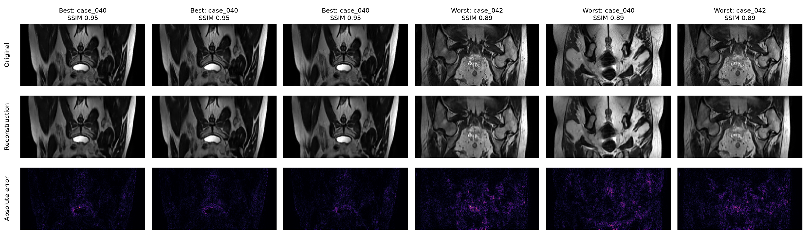
*Figure 3. Best and worst VQ-VAE-2 + aug test reconstructions. Rows: input, reconstruction, absolute error.*

Even the worst reconstruction (SSIM 0.889) is well above the target. The worst slices have fine, high-contrast texture (muscle striations, bowel gas), and the error concentrates along those edges: each bottom code covers a 4×4 patch, and the MSE loss favours a blurred average over a sharp guess. The same smoothing shows up in generated samples (Case 3, Section 7.6).

**Example 2: generation.**
- **Input:** a random seed.
- **Output:** new slices, each checked against its most similar training slice.

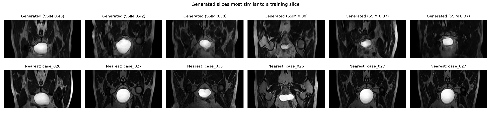
*Figure 4. The six generated slices most similar to any training slice (top) and that training slice (bottom). Even the closest samples are new slices, not copies.*

**Example 3: interpolation** between real test slices of different patients.

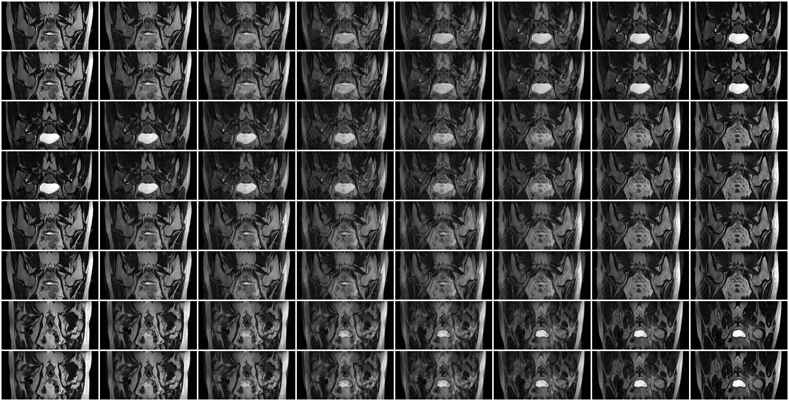
*Figure 5. VQ-VAE-2 + aug latent interpolation (each model path is followed by a pixel cross-fade of the same end frames).*

## 6. Pre-processing and data splits

**Data:** `HipMRI_Study_open/keras_slices_data` on Rangpur, 12,660 2D NIfTI slices from 38 patients. Only the images are used; the segmentation masks are not.

| Step | What | Why |
|---|---|---|
| Transpose | 256×128 → 1×128×256 | Puts the body horizontal, as in a standard axial view |
| Centre-crop | The 60 slices of 256×144 lose 8 rows top and bottom | One shape for every slice. Cropping keeps these slices instead of discarding them, and only background is removed |
| Per-slice normalisation | Clip at the 99.5th percentile, scale to [0, 1] (GANs: [−1, 1] for tanh) | Raw scales differ between scans (e.g. 0–411); clipping stops a few bright pixels squashing the rest |
| Augmentation (training only) | Random left-right flip; the priors learn from the codes of every slice *and* its mirror | Pelvic anatomy is roughly left-right symmetric, and 31 patients is a small cohort |

**Splits:** the provided patient folders.

| Split | Patients | Slices | Used for |
|---|---|---|---|
| Train | 31 | 11,460 | fitting every model |
| Validate | 4 | 660 | checkpoints, early stopping, temperature and model choice |
| Test | 3 | 540 | final numbers only, scored once |

**Why these splits:**
- **Split by patient, not by slice.** Neighbouring slices of one patient are nearly identical. A slice-level split would put near-duplicates in both train and test, inflate every score and hide memorisation. `check_no_patient_leakage()` confirms zero overlap (and a test checks that it catches a shared patient).
- **Validation chooses, test reports.** Choosing a temperature or model by looking at test scores would bias the reported numbers upwards. Every decision in Section 7 was made on validation patients, and test patients were scored once at the end.
- **Same split for every model,** so the benchmark is like for like.

## 7. Open Research Dilemma

**Question:** does a likelihood-based discrete-latent model (VQ-VAE-2 + PixelCNN priors) beat adversarial baselines at generating *realistic, diverse and non-memorised* MRI, and at what cost?

### 7.1 Evaluation protocol

**SSIM > 0.6.** The task asks for SSIM > 0.6 across the synthesised cohort against reference anatomical slices, and notes that the target is negotiable with the teaching staff depending on the problem. For VQ-VAE models, the teaching team confirmed on the course forum (20 Oct) that the 0.6 target applies to test reconstructions. This report therefore measures SSIM in both senses:
- **Paired, against the 0.6 target:** each test slice against its own reconstruction. VQ-VAE-2 + aug scores 0.919, with every one of the 540 test slices above 0.6.
- **Unpaired, synthesised cohort against reference slices:** each generated slice against its closest training and held-out slices ("similarity to train", near-copies). Real unseen patients only reach 0.26–0.30 against the training set, so a cohort above 0.6 would be closer to the training scans than real new patients are, which is memorisation. Here the target is the real-patient value, and SSIM acts as the privacy audit.
- **Generation quality** (distributional coverage) is measured with FID and KID on Inception-v3 features.

| Metric | What it measures | Good value |
|---|---|---|
| Reconstruction SSIM | autoencoder(x) vs x on test slices | > 0.6 |
| FID (Heusel et al., 2017) | distance between Inception feature distributions of generated and real slices | close to the real floor |
| KID ×1000 (Bińkowski et al., 2018) | the same idea, but unbiased at small sample sizes, so it is the main metric | close to the real floor |
| Real floor | FID/KID of 768 random *real training* slices against the reference | the best a generator can expect |
| Near-copies | samples closer to a training slice (SSIM) than any real held-out slice ever is | ≤ 5 % |
| Similarity to train | mean SSIM of each sample to its closest training slice | ≤ real held-out |
| Pairwise SSIM | mean SSIM between samples (diversity) | ≤ real held-out |

Each generator is scored on **3 seeds × 256 samples**: 768 slices against 660 validation or 540 test slices.

**Selection rule, fixed before any FID was computed:**
1. Admissible = near-copies ≤ 5 % on validation.
2. Among admissible configurations, pick the lowest validation KID.
3. If KIDs overlap within their std, pick the one with fewer near-copies.

### 7.2 Model selection (validation patients only)

Validation reference: 4 patients. Real floor: FID 59.2, KID 16.7. Real slices: similarity to train 0.259, pairwise 0.154.

| Model | FID ↓ | KID×1000 ↓ | Near-copies | Sim. to train | Pairwise | Admissible |
|---|---|---|---|---|---|---|
| DCGAN | 120.4 | 101.4 ± 1.7 | 2.6 % | 0.271 | 0.155 | Yes |
| **DCGAN + aug** | **85.9** | **52.1 ± 1.3** | 2.0 % | 0.266 | 0.161 | Yes, **selected** |
| WGAN-GP | 129.5 | 108.5 ± 1.8 | 9.4 % | 0.297 | 0.174 | No |
| VQ-VAE, T = 1.0 / 0.95 / 0.9 | 195.3 / 185.2 / 184.5 | 216.2 / 199.3 / 196.8 | 0.4 / 1.4 / 3.5 % | 0.267–0.294 | 0.181–0.223 | Yes |
| VQ-VAE-2, T = 1.0 | 146.6 | 145.3 ± 1.6 | 2.5 % | 0.292 | 0.210 | Yes |
| VQ-VAE-2, T = 0.95 | 141.8 | 136.4 ± 1.7 | 4.6 % | 0.303 | 0.227 | Yes |
| VQ-VAE-2, T = 0.9 | 136.8 | 127.8 ± 1.9 | 8.6 % | 0.315 | 0.247 | No |
| VQ-VAE-2 + aug, T = 1.0 | 162.7 | 177.3 ± 2.6 | 0.4 % | 0.237 | 0.144 | Yes |
| VQ-VAE-2 + aug, T = 0.95 | 147.7 | 152.4 ± 2.3 | 0.1 % | 0.250 | 0.159 | Yes |
| **VQ-VAE-2 + aug, T = 0.9** | **135.1** | **130.9 ± 1.9** | 1.2 % | 0.264 | 0.176 | Yes, **best VQ** |

**Truncated sampling.** Temperature reshapes the whole distribution over 512 codes. Even at T = 0.9, the ~500 unlikely codes together keep some probability, and across 2,560 sequential draws a few of them are picked, which is where broken anatomy starts. Truncation removes that tail. For example, with probabilities [0.60, 0.25, 0.10, 0.04, 0.01], top-k = 2 samples only from the first two codes (renormalised to 0.71 / 0.29), and top-p = 0.9 keeps the smallest set reaching 0.9 (the first three). We tried four settings on the best prior (VQ-VAE-2 + aug), under the same rule:

| Sampling (VQ-VAE-2 + aug) | FID ↓ | KID×1000 ↓ | Near-copies | Sim. to train | Pairwise | Admissible |
|---|---|---|---|---|---|---|
| T = 0.9, full distribution (from above) | 135.1 | 130.9 ± 1.9 | 1.2 % | 0.264 | 0.176 | Yes |
| **T = 1.0, top-k 32** | **131.5** | **115.5 ± 2.1** | 4.9 % | 0.303 | 0.245 | Yes, **best VQ** |
| T = 1.0, top-p 0.9 | 119.8 | 105.8 ± 1.6 | 5.9 % | 0.294 | 0.222 | No |
| T = 0.9, top-p 0.95 | 117.8 | 103.3 ± 1.5 | 7.6 % | 0.298 | 0.227 | No |
| T = 1.0, top level at T = 0.8 | 138.8 | 134.1 ± 1.9 | 3.6 % | 0.280 | 0.197 | Yes |

**The rule's outcome:**
- **Overall:** DCGAN + aug.
- **Best Hard-model configuration:** VQ-VAE-2 + aug with top-k 32 sampling, whose KID does not overlap with the 130.9 ± 1.9 of full sampling at T = 0.9. It passes the privacy limit only narrowly (4.9 % ± 0.9 % over seeds), and it is clearly less varied than real slices (pairwise 0.245 vs 0.154). Because the rule was fixed in advance, it is still the one sent to test; full sampling at T = 0.9 is reported alongside it.
- **Within the VQ family:** two levels beat one by about 45 FID, and augmentation removed most of the memorisation, cutting near-copies at T = 0.9 from 8.6 % to 1.2 %.
- **Every gain in KID from truncation costs privacy and diversity** (Case 5, Section 7.6). The best truncated KID, 103 (which breaks the privacy limit), is still twice DCGAN + aug's 52.

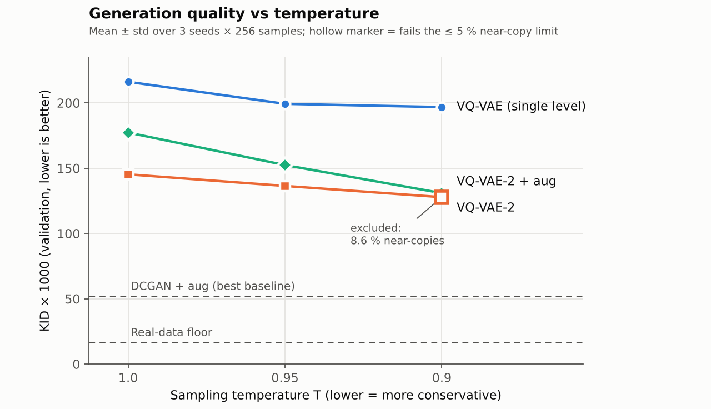
*Figure 6. Validation KID against sampling temperature. Two levels beat one at every temperature, and lower temperature improves quality but raises copying (hollow marker = fails the 5 % limit).*

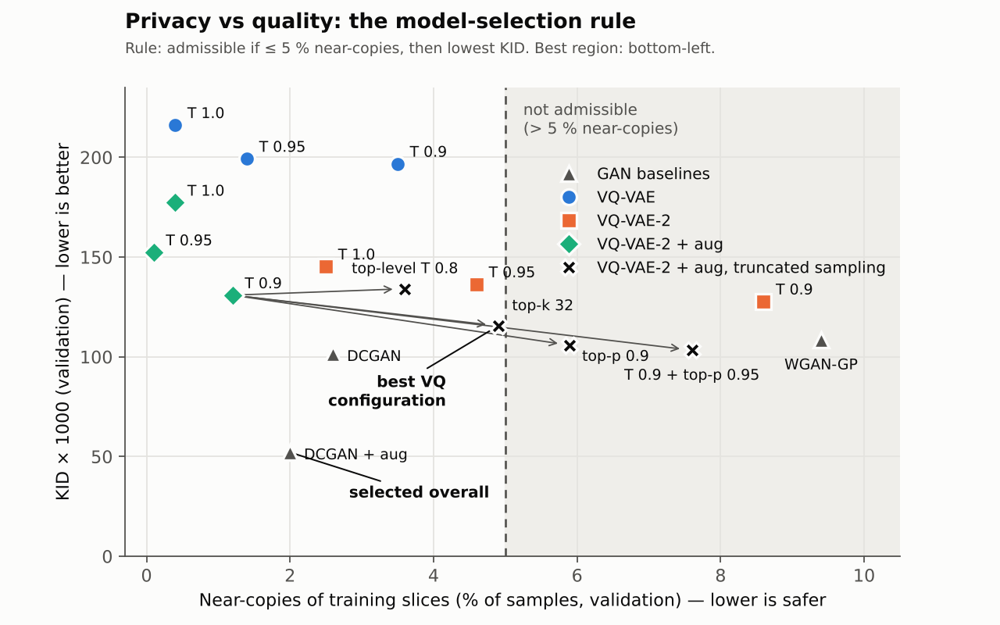
*Figure 7. The selection rule as a picture: every configuration's near-copy rate against its KID. Configurations in the shaded region are not admissible; among the rest, the lowest point wins. Arrows run from full sampling (T = 0.9) to each truncated variant: each step down in KID is also a step right, towards copying.*

### 7.3 Final benchmark (test patients, scored once)

Test reference: 3 patients. Real floor: FID 50.9, KID 10.1. Real slices: similarity to train 0.301, pairwise 0.193.

| Model | FID ↓ | KID×1000 ↓ | Near-copies /256 | Sim. to train | Pairwise | Recon. SSIM |
|---|---|---|---|---|---|---|
| **DCGAN + aug** | **86.1** | **51.0 ± 1.3** | 1.0 ± 0.0 | 0.266 | 0.161 | — |
| DCGAN | 119.2 | 101.9 ± 1.5 | 1.7 ± 1.2 | 0.271 | 0.155 | — |
| WGAN-GP | 122.6 | 94.3 ± 1.8 | 5.0 ± 2.0 | 0.297 | 0.174 | — |
| **VQ-VAE-2 + aug, top-k 32** | 117.8 | 91.8 ± 1.8 | 1.7 ± 1.2 | 0.303 | 0.245 | **0.919** |
| VQ-VAE-2 + aug, T = 0.9 | 127.0 | 112.5 ± 1.9 | 1.0 ± 1.0 | 0.264 | 0.176 | **0.919** |
| VQ-VAE-2, T = 0.95 | 127.5 | 110.6 ± 1.5 | 1.0 ± 1.0 | 0.303 | 0.227 | 0.901 |
| VQ-VAE, T = 0.95 | 174.4 | 175.0 ± 1.8 | 0.3 ± 0.6 | 0.282 | 0.202 | 0.906 |

**Findings:**
- **The validation ranking held on test:** DCGAN + aug, then the GANs and VQ-VAE-2, then the single-level VQ-VAE. So the selection generalised.
- **Augmentation helped VQ-VAE-2 everywhere except FID.** It improved reconstruction (0.901 → 0.919), privacy (similarity to train 0.303 → 0.264, now below real patients' 0.301) and diversity (0.227 → 0.176). On test FID/KID it was level with the non-augmented model.
- **Truncation held up on test:** top-k 32 improves KID from 112.5 to 91.8. It stays private (0.7 % near-copies; similarity to train 0.303, level with real patients' 0.301), but its samples are less varied than real slices (0.245 vs 0.193), so it fails the diversity criterion.
- **The best baseline wins on perceptual quality and speed.** DCGAN + aug and VQ-VAE-2 + aug at T = 0.9 are equally private (0.4 % near-copies).
- Similarity to train and pairwise SSIM describe only the samples, so they are identical against either reference; near-copy counts differ because each reference sets its own "real maximum".

| DCGAN + aug | WGAN-GP | VQ-VAE (single level), T = 0.95 |
|---|---|---|
| 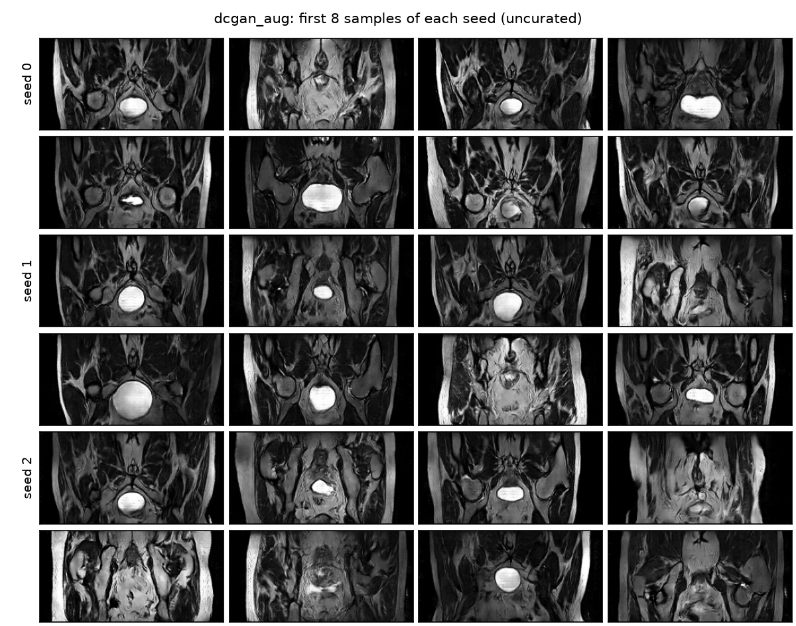 | 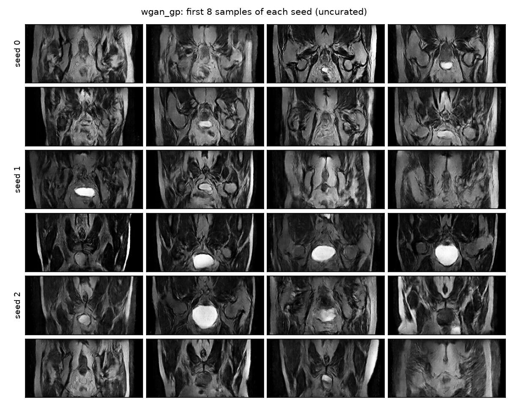 | 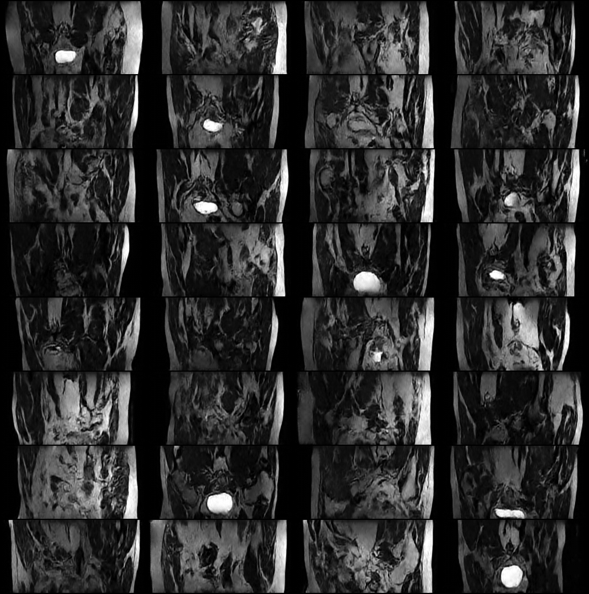 |
| **VQ-VAE-2 + aug, T = 0.9** | **VQ-VAE-2 + aug, top-k 32** | |
| 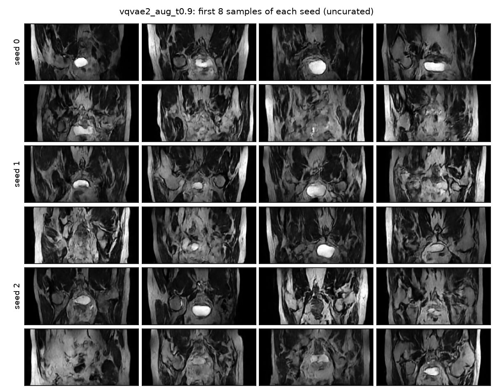 | 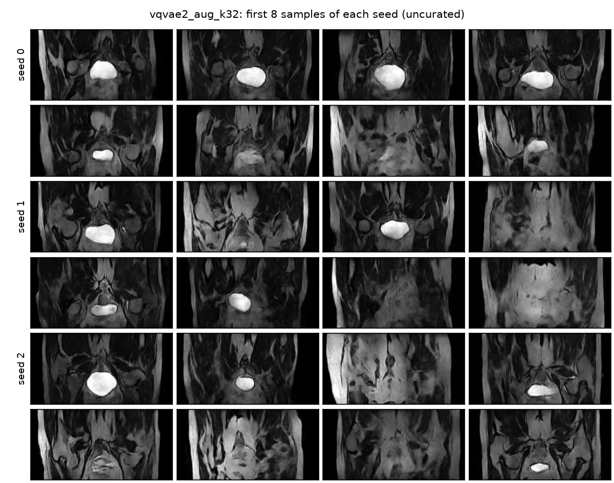 | |

*Figure 8. Uncurated samples: the first 8 samples of each of the 3 evaluation seeds, exactly as generated (the single-level VQ-VAE, not a final model, shows seed 0 only). About half of the top-k 32 samples repeat one template (a large, bright, centred bladder between symmetric hips), which is the loss of diversity measured by pairwise SSIM.*

**Interpolation** (consecutive-frame SSIM along 4 paths × 8 frames; a pixel cross-fade of the same end frames gives about 0.95):

| Model | Mean | Min |
|---|---|---|
| DCGAN + aug | 0.754 | 0.344 |
| VQ-VAE-2 + aug | **0.923** | **0.894** |

The GAN paths jump abruptly. The VQ-VAE-2 paths are smooth: at most 65–69 % of codes change in one step.

### 7.4 Training curves, early stopping and overfitting

| VQ-VAE-2 + aug autoencoder | Top prior (+ aug) | Bottom prior (+ aug) |
|---|---|---|
| 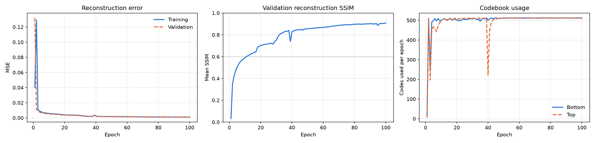 | 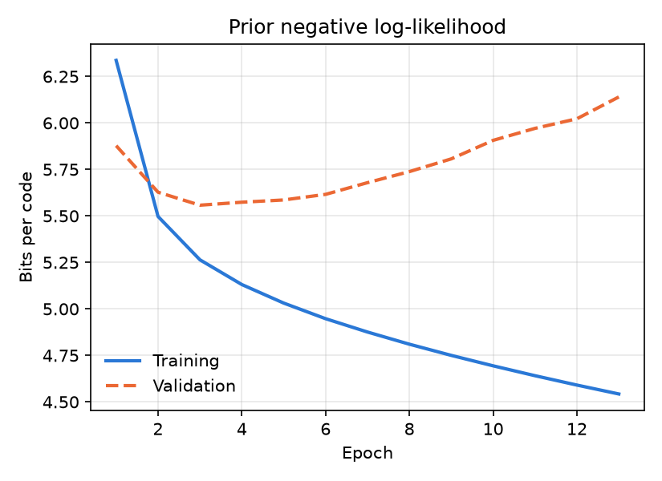 | 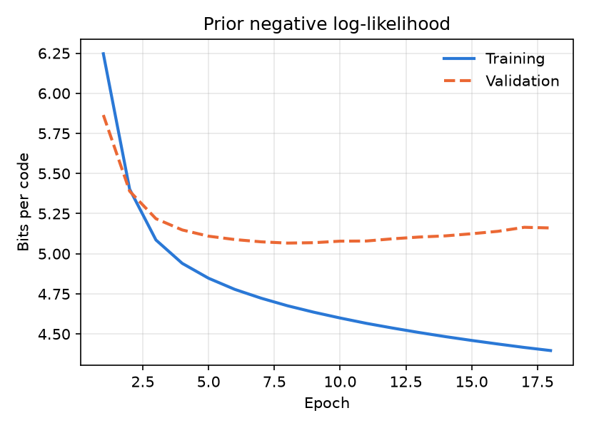 |

| DCGAN + aug | WGAN-GP | Single-level VQ-VAE |
|---|---|---|
| 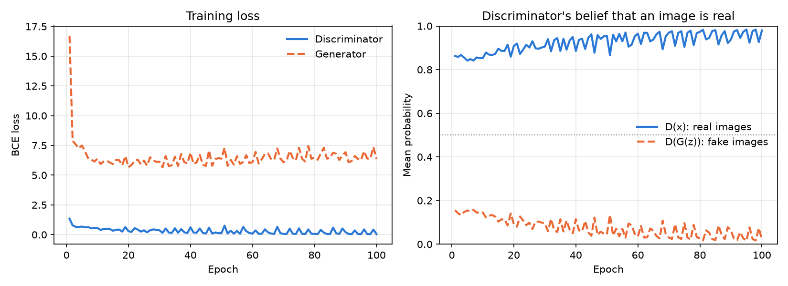 | 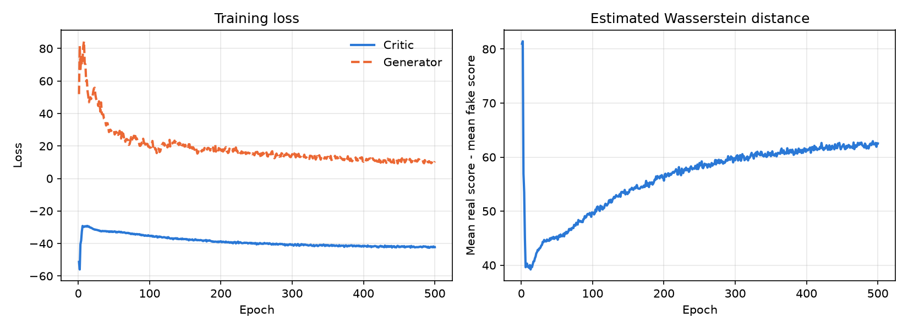 | 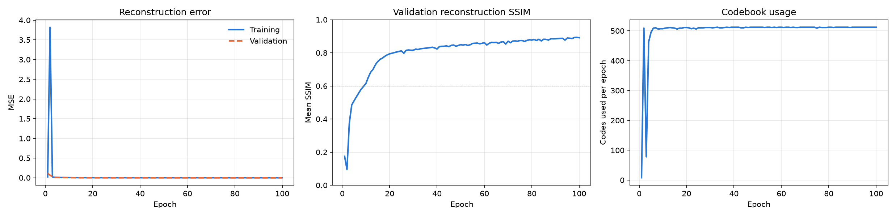 |

*Figure 9. Training curves of every final model.*

**Autoencoder.** Validation SSIM rose steadily to 0.906 at epoch 100, so early stopping never triggered.

**Priors.** The priors overfit fast: training loss keeps falling while validation loss turns upwards after a few epochs. Four defences are used together:
1. dropout 0.3;
2. AdamW weight decay 0.01;
3. flip augmentation, which doubles the training code grids to 22,920;
4. early stopping with patience 10, keeping the best-validation checkpoint.

**Why they overfit:** 31 patients is a small cohort, and neighbouring slices of one scan are near-duplicates, so a 13–15 M-parameter prior can memorise the training grids within a few epochs. The gap between training and validation loss remains, but the selected checkpoint is always the best-validation one, and augmentation lowered the best validation loss.

The top prior stopped at epoch 13 (best epoch 3) and the bottom prior at epoch 18 (best epoch 8). With augmentation, the bottom prior's best validation loss went from 5.42 to 5.07 bits per code. It is measured on a different autoencoder's codes, so this is only roughly comparable.

**GANs** have no validation loss to stop on, so they train for a fixed budget (DCGAN 100 epochs, WGAN-GP 500), with sample grids saved every 5 epochs.

### 7.5 Resource profiling (one A100)

| Model | Parameters | Peak VRAM | Training time | Inference latency |
|---|---|---|---|---|
| DCGAN (+ aug) | G 14.4 M + D 11.2 M | 1.88 GB | ~14–16 min (100 epochs) | **0.18 ms / sample** |
| WGAN-GP | G 14.4 M + critic 11.2 M | 2.54 GB | ~2 h (500 epochs) | 0.17 ms / sample |
| VQ-VAE | 690,753 | 1.27 GB | ~9 min | 0.28 ms / reconstruction |
| + single prior | 13,724,800 | 4.46 GB | ~32 min | 1.11 s / sample |
| VQ-VAE-2 + aug | 1,653,889 | 1.55 GB | ~12 min | 0.39 ms / reconstruction |
| + top prior | 13,724,800 | 2.69 GB | ~7 min (early stop) | } 1.48 s / sample |
| + bottom prior (conditioned) | 15,009,024 | 4.66 GB | ~33 min (early stop) | } (both priors + decoder) |

**Latency** is timed over 256 samples generated together. A PixelCNN needs one network pass per code position: 512 + 2,048 passes for VQ-VAE-2. That makes it compute-bound, so larger batches did not reduce the time per sample. Every model meets the 2 h / 8 GB training budget; only VQ sampling misses 1 s per slice.

### 7.6 Error autopsies

Five failure cases in generated slices, each traced to its root trigger.

**Case 1. Jumbled global anatomy (single-level prior).**
- **Failure mode:** realistic texture, but no coherent pelvis. Hip joints were missing, the bladder was often in the left third of the image, and occasionally there were two bladders (Figure 8, top right).
- **Root trigger:** the prior places 2,048 codes of 4×4 px in raster order. Early rows are fixed before anything decides where the later anatomy belongs.
- **Fix:** VQ-VAE-2's 8×8-px top level plans the layout first. FID improves by about 45 at every temperature, and the bladder is centred far more often (Figure 8). **Fixed.**

**Case 2. Anatomically incoherent "texture-only" samples (VQ-VAE-2 + aug).**
- **Failure mode:** by eye, about a third of uncurated samples at T = 0.9 (Figure 8) contain no bladder, no femoral heads and no left-right symmetry, only fragmented tissue with boundaries that no real slice has (Figure 10a–c). Real slices near the front and back of a scan also lack a bladder, but they keep smooth, symmetric tissue planes.
- **Root trigger:** the top prior commits to the layout in raster order. One unlikely code in the first rows sends the layout somewhere no training slice went, and the bottom prior then fills a plausible local texture into an impossible plan. With 31 patients, the prior's tail of unlikely codes is poorly estimated: the top prior's best validation loss, 5.56 bits per code, came at epoch 3, before it began to overfit (Section 7.4).
- **Attempted fix:** truncated sampling (Case 5) removes that tail. The fragmented samples become rarer, but some failures remain as washed-out, featureless slices (Figure 8, top-k 32), and diversity drops.
- **Lesson:** this is the hallucination risk in the task's dilemma. Before release, every synthetic slice should pass an anatomy check (Section 7.8).

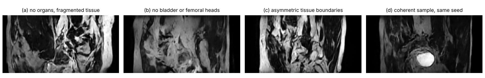
*Figure 10. (a)–(c) Texture-only VQ-VAE-2 + aug samples; (d) a coherent sample of the same seed, for contrast.*

**Case 3. Wrong texture statistics: GAN speckle and VQ smoothing.**
- **Failure mode:** in DCGAN + aug samples, bright fat bands carry a fine pixel speckle that real slices do not have. VQ-VAE-2 samples go the other way: they are smoother than real slices (Figure 11).
- **Measurement:** the share of each slice's spectral power above 0.25 cycles per pixel, over all 768 cached samples and the 540 real test slices (`sample_figures.py`):

  | | Real test | DCGAN + aug | WGAN-GP | VQ-VAE-2 + aug, T = 0.9 | top-k 32 |
  |---|---|---|---|---|---|
  | High-frequency power share | 0.0257 ± 0.0058 | 0.0351 ± 0.0089 | 0.0253 ± 0.0080 | 0.0128 ± 0.0030 | 0.0088 ± 0.0027 |
  | Relative to real | 1.00 | **1.37** | 0.98 | **0.50** | 0.34 |

- **Root trigger:** DCGAN's generator upsamples with stride-2 transposed convolutions, which are known to leave high-frequency artefacts (Odena et al., 2016). WGAN-GP uses the same generator yet matches the real value, so the artefact is not inevitable with this architecture; the training objective is the difference between the two. VQ-VAE-2's decoder is trained with MSE on 4×4 patches, which favours blur (Section 5), and truncated sampling smooths the samples further.
- **Next step:** resize-then-convolve upsampling for the GAN; a perceptual or adversarial loss on the VQ decoder, as in VQGAN.

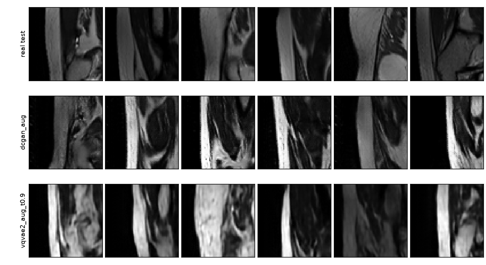
*Figure 11. The same 64 × 64 corner (left fat band) of random real test slices and generated slices, at native resolution.*

**Case 4. WGAN-GP copies training slices.**
- **Failure mode:** 9.4 % of WGAN-GP samples on validation (5.0 of 256 on test) are closer to a specific training slice than any real unseen patient ever is.
- **Root trigger:** the critic is only loosely constrained (gradient-penalty term about 2), and nothing in the GAN objective discourages reproducing a training example. Its Wasserstein estimate *rose* from 40 to 62 while the images improved, so the loss gave no warning.
- **Lesson:** a good average hides leaky tails, so audit the tail of the distribution, not just the mean.

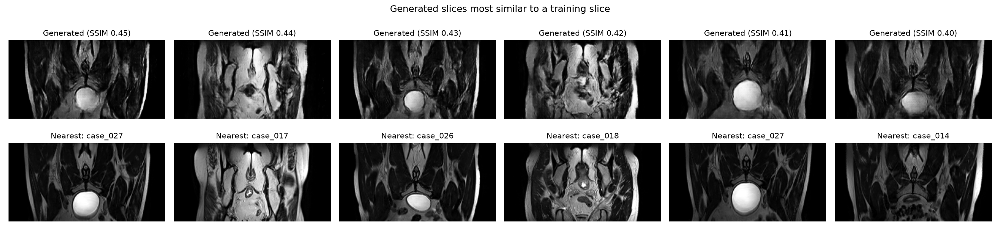
*Figure 12. WGAN-GP samples (top) and their nearest training slices (bottom).*

**Case 5. The prior limits FID, and truncated sampling cannot fix it.**
- **Failure mode:** VQ-VAE-2 + aug samples score FID 127 on test, far above the real floor of 51.
- **Diagnosis:** we scored the autoencoder's *reconstructions* of the floor slices with `predict.py --model vqvae2 --fid`. This splits the gap into two parts:
  ```
  test FID:  51 ─────── 65 ────────────────────── 127
            real     reconstructed           generated
            floor    (decoder costs 14)      (prior costs 62)
  ```
- **Attempted fix:** cut the prior's tail of unlikely codes with top-k (Fan et al., 2018) or top-p (Holtzman et al., 2020) sampling, or lower the temperature only for the layout level. KID improved (validation 131 → 103; test 112.5 → 91.8 for top-k 32), but every truncated setting moved samples towards the training set and made them more alike:

  | Validation | Full, T = 0.9 | top-k 32 | top-p 0.9 | T 0.9 + top-p 0.95 |
  |---|---|---|---|---|
  | KID×1000 | 130.9 | 115.5 | 105.8 | 103.3 |
  | Near-copies | 1.2 % | 4.9 % | 5.9 % | 7.6 % |
  | Sim. to train (real 0.259) | 0.264 | 0.303 | 0.294 | 0.298 |
  | Pairwise (real 0.154) | 0.176 | 0.245 | 0.222 | 0.227 |

- **Root trigger (most likely):** with 31 training patients, the codes the prior is most confident about are the ones it saw most often in training. Keeping only those removes broken anatomy, but also novelty. A lower temperature for the top level alone did not help (KID 134.1), so the errors are not confined to the layout.
- **Lesson:** the remaining gap to DCGAN is in what the prior has learned, not in how it is sampled. Even the best truncated setting, which breaks the privacy limit, sits at twice DCGAN + aug's KID. Closing it needs a stronger prior (a transformer, as in VQGAN), not a sampling trick.

### 7.7 Outcome against the feasibility criteria

| Criterion | VQ-VAE-2 + aug, top-k 32 | VQ-VAE-2 + aug, T = 0.9 | DCGAN + aug |
|---|---|---|---|
| 1. Fidelity: reconstruction SSIM > 0.6 | Met: 0.919 (min 0.889) | Met: 0.919 | — |
| 2. Quality vs floor and baselines | Not met: FID 118 vs floor 51 | Not met: FID 127 vs floor 51 | Partly met: FID 86 vs floor 51, best of all models |
| 3. No memorisation (≤ 5 % near-copies) | Met: 0.7 %, level with real patients | Met: 0.4 %, less similar to train than real patients | Met: 0.4 % |
| 4. Diversity (pairwise ≤ real) | Not met: 0.245 vs 0.193 | Met: 0.176 vs 0.193 | Met: 0.161 vs 0.193 |
| 5. Resources (≤ 2 h, ≤ 8 GB) | Met (but 1.50 s per sample) | Met (but 1.48 s per sample) | Met |

### 7.8 Recommendation for the project manager

**Verdict on the synthetic cohort**, as the task asks:

| Question | DCGAN + aug | VQ-VAE-2 + aug, T = 0.9 |
|---|---|---|
| **Safe / non-memorised?** | **Yes.** 0.4 % near-copies on test; samples are on average less similar to training than real patients are (0.266 vs 0.301) | **Yes.** 0.4 % near-copies; similarity to train 0.264, below real patients' 0.301 |
| **Diverse (no mode collapse)?** | **Yes.** Pairwise SSIM 0.161 vs real 0.193 | **Yes.** 0.176 vs 0.193 (top-k 32: **no**, 0.245) |
| **Clinically plausible?** | **Mostly.** Coherent anatomy in most samples, but grainy texture (Case 3) | **Not yet.** About a third of samples have incoherent anatomy (Case 2) and texture is too smooth |
| **Fit for downstream training?** | For research augmentation, after filtering (below) | Not without an anatomy filter; better used as an encoder |

So the cohort is **safe to share in terms of memorisation**, but **neither model is clinically plausible enough to train a diagnostic model on without review**. Both need the release checks below.

**For a shareable synthetic cohort, ship DCGAN + aug.** On test patients it has:
- the best perceptual quality (FID 86, KID 51);
- the same privacy as the Hard model with full sampling (0.4 % near-copies);
- diversity close to real;
- sampling about **8,000× faster** (0.18 ms per slice, so a 10,000-slice cohort takes about 2 seconds instead of about 4 GPU-hours).

**Keep VQ-VAE-2 + aug for anything that needs an encoder:**
- compressing or reconstructing real scans (SSIM 0.919);
- smooth latent interpolation between patients (0.92 vs 0.75);
- a model whose likelihood can be measured and monitored for overfitting.

| If the priority is… | Choose | Trade-off |
|---|---|---|
| Realistic synthetic slices, fast | DCGAN + aug | No encoder; jumpy latent space; no likelihood |
| Reconstruction, compression, smooth latent paths | VQ-VAE-2 + aug, T = 0.9 | FID 127; 1.48 s per slice |
| Cleanest VQ samples | VQ-VAE-2 + aug, top-k 32 | KID 92, but less varied than real slices |
| Lowest copying risk at any cost | VQ-VAE-2 + aug, T = 0.95 | 0.1 % near-copies, but FID 148 |
| Avoid | WGAN-GP | 9.4 % near-copies on validation |

**Before any release, whichever model is used:**
1. Run the near-copy audit and drop samples above the real-patient maximum.
2. Have a radiologist review a random subset.
3. Use flip augmentation; it was the single most effective change for both families.

## 8. Discussion and conclusion

**What worked.**
- **The Hard model meets four of its five criteria with full sampling (T = 0.9); only quality is not met:**
  - reconstruction SSIM 0.919 on unseen patients (target 0.6);
  - near-copy rate 0.4 %;
  - sample diversity close to real data;
  - the 2 h / 8 GB training budget.

  Top-k 32 sampling improves quality (test KID 112.5 → 91.8) but gives up the diversity criterion.
- **Two-level structure** fixed the jumbled anatomy of the single-level model, and FID confirmed the visual improvement (about 45 points).
- **Flip augmentation** was the most valuable single change. It halved DCGAN's KID, and it cured VQ-VAE-2's tendency to stay close to training slices.
- **The evaluation can be trusted:**
  - selection on validation only;
  - test scored once;
  - three seeds per configuration;
  - a real-data floor for context;
  - 31 tests checking the models, the masks, the sampling filters and the metrics (SSIM and FID against reference implementations).

**What did not work.**
- **Perceptual quality:** VQ-VAE-2 does not beat the best GAN baseline. The decoder diagnostic shows the reason: the PixelCNN prior accounts for most of the gap to real data.
- **Truncated sampling closed only part of that gap.** Top-k 32 improved test KID from 112.5 to 91.8, but made samples less varied than real data, and the settings that went further broke the privacy limit. The gap therefore comes from what the prior has learned from 31 patients, not from how it is sampled.
- **Speed:** PixelCNN sampling is about 8,000× slower than a GAN, and no batching can fix this, because it is sequential by design.

**Answer to the research dilemma.** On this dataset, the likelihood-based model is the better *autoencoder* and an equally private generator, but not the better *sampler*. The best adversarial baseline, once augmented, produces more realistic slices far faster with the same privacy.

**Limitations.**
- Only 31 training patients and 3 test patients, so test numbers carry real uncertainty.
- FID uses ImageNet features, which suit MRI imperfectly.
- Slices are generated in 2D, without consistency between neighbouring slices.

**Future work, by expected value:**
1. A transformer or MaskGIT-style prior, for better and parallel sampling.
2. A perceptual or adversarial decoder loss, as in VQGAN, for sharper texture.
3. An MRI-specific feature extractor for FID.
4. 3D generation, for volume consistency.

## 9. Artificial Intelligence Usage Disclosure

**Tool used:** Claude (Anthropic), as a chat assistant throughout the project.

**What it helped with:**
- **Understanding the project requirements:** reading the task specification and the course forum answers with me, and turning them into a checklist of what the report and code had to contain.
- **Learning concepts:** explanations, with worked examples, of vector quantisation, the straight-through estimator, gated PixelCNN masking, FID and KID, and truncated (top-k / top-p) sampling.
- **Code:** drafting and refactoring parts of the code, such as the training loops, the evaluation functions and the tests, and debugging errors from Rangpur jobs.
- **Structuring the files and the README:** organising the code into the required modules, and the layout and wording of this report.

**How I checked it:**
- I ran every experiment myself on Rangpur, and every number in this report comes from those runs. The logs of the final runs are in [`logs/`](logs/).
- The code is covered by 31 tests (`tests/`), including a causality test for the PixelCNN masks, checks of SSIM and FID against reference implementations (scikit-image and SciPy), and a behaviour test for KID. A deliberately broken mask makes the causality test fail, so the test does detect real errors.
- New options (augmentation, early stopping, gradient clipping, truncated sampling) were checked to give exactly the same results as the old code when switched off.
- Retraining the priors with the same seed reproduced the original results, and the validation ranking held on the test patients.
- I decided the model choices, the selection rule (fixed before any FID was computed) and the final recommendation, and I can explain every part of the code.

The full conversation history is available on request.

## 10. References

- Bińkowski, M., Sutherland, D. J., Arbel, M. & Gretton, A. (2018). Demystifying MMD GANs. *ICLR*.
- Dhariwal, P. et al. (2020). Jukebox: A generative model for music. *arXiv:2005.00341*.
- Fan, A., Lewis, M. & Dauphin, Y. (2018). Hierarchical neural story generation. *ACL*.
- Gulrajani, I. et al. (2017). Improved training of Wasserstein GANs. *NeurIPS*.
- Heusel, M. et al. (2017). GANs trained by a two time-scale update rule converge to a local Nash equilibrium. *NeurIPS*.
- Holtzman, A., Buys, J., Du, L., Forbes, M. & Choi, Y. (2020). The curious case of neural text degeneration. *ICLR*.
- Loshchilov, I. & Hutter, F. (2019). Decoupled weight decay regularization. *ICLR*.
- Odena, A., Dumoulin, V. & Olah, C. (2016). Deconvolution and checkerboard artifacts. *Distill*.
- Radford, A., Metz, L. & Chintala, S. (2015). Unsupervised representation learning with deep convolutional GANs. *arXiv:1511.06434*.
- Razavi, A., van den Oord, A. & Vinyals, O. (2019). Generating diverse high-fidelity images with VQ-VAE-2. *NeurIPS*.
- Szegedy, C. et al. (2016). Rethinking the Inception architecture for computer vision. *CVPR*.
- van den Oord, A. et al. (2016). Conditional image generation with PixelCNN decoders. *NeurIPS*.
- van den Oord, A., Vinyals, O. & Kavukcuoglu, K. (2017). Neural discrete representation learning. *NeurIPS*.
- Wang, Z. et al. (2004). Image quality assessment: From error visibility to structural similarity. *IEEE TIP*, 13(4).
