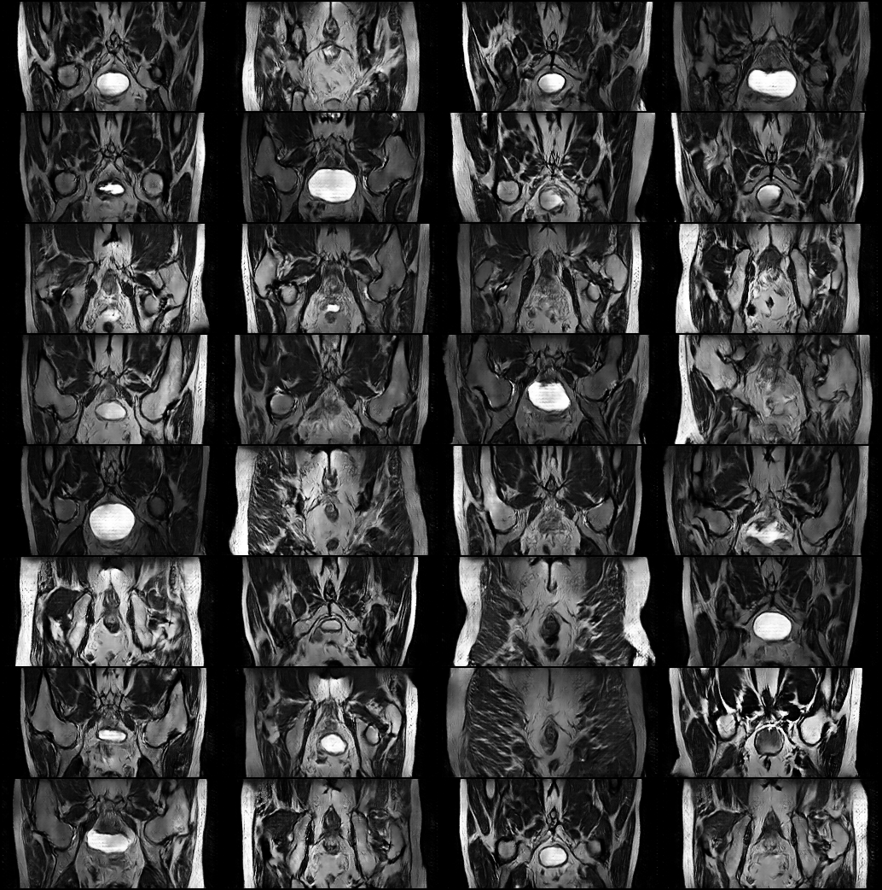

# Synthetic Prostate MRI Slices with VQ-VAE-2 and PixelCNN Priors (HipMRI)

**Gurkirat Singh Randhawa · s5054910 · COMP3710 Pattern Recognition · Task 2.4 Image Generation · Hard difficulty**

## Contents
1. [Problem and algorithm](#1-problem-and-algorithm)
2. [How it works](#2-how-it-works)
3. [Feasibility review](#3-feasibility-review)
4. [Dependencies and reproducibility](#4-dependencies-and-reproducibility)
5. [Usage, file structure, example inputs and outputs](#5-usage-file-structure-example-inputs-and-outputs)
6. [Pre-processing and data splits](#6-pre-processing-and-data-splits)
7. [Open Research Dilemma](#7-open-research-dilemma)
8. [Discussion and conclusion](#8-discussion-and-conclusion)
9. [Artificial Intelligence Usage Disclosure](#9-artificial-intelligence-usage-disclosure)
10. [References](#10-references)

## 1. Problem and algorithm

**The problem.** A research group holding the HipMRI prostate study wants a **synthetic cohort**: realistic 2D pelvic MRI slices that it can share between centres or use for augmentation, **without exposing real patients**. A useful generator has to meet three goals at once:
- **Realism:** slices look like real MRI.
- **Diversity:** no mode collapse.
- **Privacy:** no copying of training patients.

**The algorithm.** A **VQ-VAE-2** (Razavi et al., 2019) compresses each 128×256 slice into two grids of discrete codes:
- a coarse **top grid** (16×32) for the overall anatomy;
- a fine **bottom grid** (32×64) for texture.

Two **gated PixelCNN priors** (van den Oord et al., 2016) learn which code grids are plausible. A new slice is made by sampling a top grid, then a bottom grid conditioned on it, and decoding both.

**Baselines.** The model is benchmarked on identical patient-level splits against a single-level **VQ-VAE** (van den Oord et al., 2017) and two GANs, **DCGAN** and **WGAN-GP**. The two strongest families, DCGAN and VQ-VAE-2, are also trained with left-right flip augmentation as an ablation.

**Everything is implemented from scratch in PyTorch:** all models, the PixelCNN and the SSIM, FID and KID code. No pre-trained weights are used anywhere except the standard Inception-v3 inside FID, which is used only to *measure* images, as staff permitted on Ed.

**Headline results** (test patients, scored once after all choices were made on validation):

| | VQ-VAE-2 + aug (Hard model) | DCGAN + aug (best baseline) |
|---|---|---|
| Reconstruction SSIM (target > 0.6) | **0.919**, 100 % of slices > 0.6 | — (no encoder) |
| FID / KID×1000 (real floor 50.9 / 10.1) | 127.0 / 112.5 | **86.1 / 51.0** |
| Near-copies of training slices | **0.4 %** | **0.4 %** |
| Diversity, pairwise SSIM (real 0.193) | 0.176 | 0.161 |
| Sampling time per slice | 1.48 s | 0.18 ms |


*Figure 1. 32 uncurated VQ-VAE-2 + aug samples at temperature 0.9 (test run, seed 0).*

## 2. How it works


*Figure 2. Stage 1 trains the autoencoder, stage 2 trains the priors on its codes, and stage 3 generates new slices.*

### 2.1 Vector quantisation

The encoder turns an image into a grid of 64-dimensional vectors z_e. Each vector is replaced by its nearest entry in a codebook of 512 learned vectors:

  k = argmin_j ‖z_e − e_j‖²,  z_q = e_k

*Worked example.* Take z_e = (0.9, 0.1) and a codebook e₀ = (1, 0), e₁ = (0, 1). The squared distances are 0.02 and 1.62, so the vector becomes code 0.

**Loss** (sg = stop-gradient, β = 0.25):

  L = ‖x − x̂‖² + ‖sg[z_e] − e‖² + β‖z_e − sg[e]‖²

| Term | Effect |
|---|---|
| ‖x − x̂‖² | Reconstruction: the output should match the input |
| ‖sg[z_e] − e‖² | Moves the codes towards the encoder outputs |
| β‖z_e − sg[e]‖² | Keeps the encoder outputs close to their codes |

- **Straight-through estimator.** argmin has no gradient, so the decoder's gradient is copied to the encoder: `z_q = z_e + (z_q − z_e).detach()`.
- **Dead-code restarts** (Dhariwal et al., 2020). Codes that no input selects are moved onto recent encoder outputs. This raised usage from 3–4 of 512 codes to 507–512.

### 2.2 Why two levels

In a single-level VQ-VAE each code covers a 4×4-pixel patch, so the prior places 2,048 codes one by one with no plan for the global layout. In practice its samples had realistic texture but jumbled anatomy (§7.6, case 1).

VQ-VAE-2 adds a **top level whose codes each cover 8×8 pixels**. The top prior decides where the bladder, hips and rectum go first. The bottom level is quantised *with the decoded top level as context*, so its codes only need to add detail. This one change improves FID by about 45 at every temperature (§7.2).

### 2.3 Gated PixelCNN prior

The prior factorises the distribution of a code grid c in raster order (left to right, top to bottom):

  p(c) = ∏ᵢ p(cᵢ | c₁ … cᵢ₋₁)

Each factor is a 512-way softmax.

- **Network:** 12 gated layers with 128 channels, 7×7 kernels and gate tanh(a)·σ(b).
- **Two stacks:** a **vertical stack** sees the rows above and a **horizontal stack** sees the positions to the left. Together they remove the original PixelCNN's blind spot.
- **First-layer mask:** hides the current position, so no prediction sees its own answer. A test proves this (`tests/test_pixelcnn_causality.py`).
- **Conditioning:** the bottom prior embeds the top codes, upsamples them 2× and adds them before every gate.

**Temperature T.** Logits are divided by T before the softmax. *Example:* logits [2, 1, 0] give probabilities [0.67, 0.24, 0.09] at T = 1 and [0.87, 0.12, 0.02] at T = 0.5. Lower T gives safer, less varied samples.

### 2.4 Baselines

| | DCGAN (Radford et al., 2015) | WGAN-GP (Gulrajani et al., 2017) |
|---|---|---|
| Generator (shared) | z ∈ ℝ¹⁰⁰ → 4×8 block → 5 transposed convs → tanh | same |
| Discriminator / critic | 5 strided convs with batch norm | same layout with **layer norm** (the penalty is computed per sample) |
| Loss | non-saturating BCE | Wasserstein loss + gradient penalty, λ = 10, n_critic = 5 |
| Optimiser | Adam 2e-4, β = (0.5, 0.999), 100 epochs | Adam 1e-4, β = (0, 0.9), 500 epochs |

### 2.5 Hyperparameters and their justification

| Setting | Value | Why |
|---|---|---|
| Codebook | 512 codes × 64 dims per level | Large enough that 507–512 codes are used (perplexity ≈ 330), with no collapse |
| Commitment β | 0.25 | Value from the VQ-VAE paper; reconstruction was stable |
| Autoencoder optimiser | Adam 2e-4, batch 64, 100 epochs, best validation SSIM kept | Validation SSIM was still rising slowly at epoch 100 |
| Prior | 12 layers, 128 channels, 7×7 kernels | Receptive field covers most of a 32×64 grid within GPU memory |
| Prior regularisation | dropout 0.3, AdamW weight decay 0.01 | The prior overfits 31 patients within a few epochs (§7.4) |
| Prior batch | 32 | Keeps peak memory under the 8 GB budget (4.7 GB) |
| Early stopping | patience 10 on validation loss/SSIM | Stops once validation stops improving; the best epoch is kept |
| Gradient clipping | norm 1.0 (priors) | Stops one unusual batch from destabilising PixelCNN training |
| Augmentation | random left-right flip (training only) | Pelvic MRI is roughly symmetric; it doubles the data for a small cohort |
| Sampling | 3 seeds × 256 samples | Gives mean ± std, so single lucky runs don't decide anything |

## 3. Feasibility review

*One-page review, also available as [`feasibility_review.pdf`](feasibility_review.pdf).*

> **Problem and goal.** Generate realistic 2D prostate MRI slices that a research group could share or use for augmentation without exposing real patients. Check whether a VQ-VAE-2 with learned priors gives slices that are realistic, diverse and not copied from training, compared with GAN baselines.
>
> **Acceptance criteria.**
> 1. Reconstruction: test SSIM > 0.6.
> 2. Quality: FID / KID close to the real-data floor.
> 3. No memorisation: ≤ 5 % of samples closer to a training slice than any real unseen patient.
> 4. Diversity: no mode collapse (pairwise SSIM ≈ real).
> 5. Comparison: against DCGAN and WGAN-GP on the same patient split.
> 6. Resources: ≤ 2 h training per model, ≤ 8 GB GPU memory.
>
> **Approach.**
> - **Model:** VQ-VAE-2 compresses each slice into two grids of discrete codes, a coarse layout grid and a fine detail grid. Two PixelCNN priors learn which code grids are plausible; new slices come from sampling the priors and decoding.
> - **Baselines:** DCGAN and WGAN-GP.
> - **Data:** HipMRI, 38 patients, split 31 / 4 / 3 by patient (no leakage). Settings are chosen on validation; final numbers come from test.
>
> **Evidence so far.**
> - Reconstruction SSIM 0.90 on test, with every slice above 0.6.
> - The two-level model clearly improves anatomy over a single-level VQ-VAE (about 45 FID better).
> - About 1 % near-copies for VQ-VAE-2, against 9 % for WGAN-GP.
> - All models train in under 2 h at under 5 GB GPU memory.
>
> **Risks and fallback.**
>
> | Risk | Plan |
> |---|---|
> | Prior overfits (small dataset) | Dropout, weight decay, augmentation, early stopping |
> | Sampling is slow (about 1.5 s per slice) | Accept as a trade-off; faster prior as future work |
> | GAN baseline scores better FID | Report honestly and compare trade-offs |
>
> **Fallback:** WGAN-GP with the same evaluation (Normal difficulty).

The final outcome against each criterion is in §7.7.

## 4. Dependencies and reproducibility

| Package | Version | Used for |
|---|---|---|
| Python | 3.11.15 | |
| PyTorch | 2.13.0 (+cu130) | models and training |
| torchvision | 0.28.0 | image grids |
| numpy | 2.4.6 | arrays |
| nibabel | 5.4.2 | reading NIfTI slices |
| matplotlib | 3.11.2 | figures |
| tqdm | 4.70.1 | progress bars |
| pillow | 12.3.0 | image saving |
| pytorch-fid | 0.3.0 | Inception-v3 weights for FID/KID only |
| scikit-image, scipy | 0.26.0, 1.17.1 | tests that check SSIM and FID against reference implementations |
| pytest | 9.1.1 | running `tests/` |

Install PyTorch for your CUDA version first, then:
```bash
pip install -r requirements.txt
pip install --no-deps pytorch-fid==0.3.0   # --no-deps keeps the CUDA build of PyTorch
```
Hardware: one NVIDIA A100 on UQ's Rangpur cluster (`comp3710` partition). The Slurm scripts set `TORCH_HOME` so the compute nodes find the FID weights.

**Reproducibility.**
- **Fixed seeds:** 42 for training; 0, 1 and 2 for sampling.
- **Fixed splits:** the provided patient folders, with a leakage check every time data is loaded.
- **Tested:** retraining the VQ-VAE-2 top prior with the same seed reproduced it **bit for bit**. The bottom prior matched to within ±0.005 bits per code, the remaining difference coming from non-deterministic GPU kernels.
- **Reported spread:** every generation metric is a mean ± std over 3 seeds, because near-copy counts alone varied by 0–3 between runs.
- **Logs:** the training and evaluation logs behind every number are in [`logs/`](logs/).
- **Weights:** not committed (size); the commands in §5 recreate the Hard model in about 1 A100-hour.

## 5. Usage, file structure, example inputs and outputs

```
dataset.py         NIfTI loading, transpose, centre-crop, per-slice normalisation, flip augmentation,
                   patient-leakage check
modules.py         DCGAN generator/discriminator, WGAN-GP critic, VQ-VAE, VQ-VAE-2, gated PixelCNN
metrics.py         batched GPU SSIM (paired, best-match, pairwise), FID and KID
train.py           training driver for every model
predict.py         evaluation driver: reconstruction, FID/KID, memorisation audit, interpolation
slurm_train.sh     Slurm job for train.py on one A100
slurm_predict.sh   Slurm job for predict.py on one A100
tests/             25 tests: model shapes, PixelCNN causality, preprocessing, metrics
images/            figures used in this README
logs/              training and evaluation logs of the final runs
```

**Train the final Hard model** (outputs go to `~/hipmri_runs/<run>/`):
```bash
python3 dataset.py && python3 -m pytest tests/ -q        # data audit, then 25 tests
sbatch slurm_train.sh --model vqvae2 --epochs 100 --augment --patience 10 --run-name vqvae2_aug
P="--augment --grad-clip 1.0 --patience 10 --prior-dropout 0.3 --weight-decay 0.01 --batch-size 32 --epochs 40"
sbatch slurm_train.sh --model pixelcnn --level top    --vqvae-weights ~/hipmri_runs/vqvae2_aug/vqvae2.pt $P --run-name pixelcnn2_aug_top
sbatch slurm_train.sh --model pixelcnn --level bottom --vqvae-weights ~/hipmri_runs/vqvae2_aug/vqvae2.pt $P --run-name pixelcnn2_aug
```

**Evaluate it:**
```bash
TOP="--top-weights ~/hipmri_runs/pixelcnn2_aug_top/pixelcnn.pt"
sbatch slurm_predict.sh --model vqvae2 --run-name vqvae2_aug                     # reconstruction SSIM on test
sbatch slurm_predict.sh --model pixelcnn2 --run-name pixelcnn2_aug $TOP --fid --repeats 3 --temperature 0.9 --reference validate
sbatch slurm_predict.sh --model pixelcnn2 --run-name pixelcnn2_aug $TOP --repeats 3 --temperature 0.9 --reference validate
sbatch slurm_predict.sh --model vqvae2 --run-name vqvae2_aug --interpolate
```
- **`--fid`:** FID/KID scoring; otherwise the memorisation audit runs.
- **`--reference validate`:** use this while choosing settings.
- **`--reference test`:** use this once, for the final numbers.

**Baselines:**
```bash
sbatch slurm_train.sh --model dcgan --epochs 100 --augment --run-name dcgan_aug
sbatch slurm_train.sh --model wgan_gp --epochs 500
```

**Example 1: reconstruction.**
- **Input:** a test slice (1×128×256, values in [0, 1]).
- **Output:** its reconstruction and the error map.
- **Log line:** `Reconstruction SSIM on 540 test slices: mean 0.919, std 0.014, min 0.889, max 0.949, 100% above 0.6`


*Figure 3. Best and worst VQ-VAE-2 + aug test reconstructions. Rows: input, reconstruction, absolute error.*

**Example 2: generation.**
- **Input:** a random seed.
- **Output:** new slices, each checked against its most similar training slice.


*Figure 4. The six generated slices most similar to any training slice (top) and that training slice (bottom). Even the closest samples are new slices, not copies.*

**Example 3: interpolation** between real test slices of different patients.


*Figure 5. VQ-VAE-2 + aug latent interpolation (each model path is followed by a pixel cross-fade of the same end frames).*

## 6. Pre-processing and data splits

**Data:** `HipMRI_Study_open/keras_slices_data` on Rangpur, 12,660 2D NIfTI slices from 38 patients. Only the images are used; the segmentation masks are not.

| Step | What | Why |
|---|---|---|
| Transpose | 256×128 → 1×128×256 | Puts the body horizontal, as in a standard axial view |
| Centre-crop | The 60 slices of 256×144 lose 8 rows top and bottom | One shape for every slice. Staff confirmed on Ed (#177) that these slices may even be discarded; cropping keeps them, and only background is removed |
| Per-slice normalisation | Clip at the 99.5th percentile, scale to [0, 1] (GANs: [−1, 1] for tanh) | Raw scales differ between scans (e.g. 0–411); clipping stops a few bright pixels squashing the rest |
| Augmentation (training only) | Random left-right flip; the priors learn from the codes of every slice *and* its mirror | Pelvic anatomy is roughly left-right symmetric, and 31 patients is a small cohort |

**Splits:** the provided patient folders.

| Split | Patients | Slices | Used for |
|---|---|---|---|
| Train | 31 | 11,460 | fitting every model |
| Validate | 4 | 660 | checkpoints, early stopping, temperature and model choice |
| Test | 3 | 540 | final numbers only, scored once |

**Why these splits:**
- **Split by patient, not by slice.** Neighbouring slices of one patient are nearly identical. A slice-level split would put near-duplicates in both train and test, inflate every score and hide memorisation. `check_no_patient_leakage()` confirms zero overlap (and a test checks that it catches a shared patient).
- **Validation chooses, test reports.** Choosing a temperature or model by looking at test scores would bias the reported numbers upwards. Every decision in §7 was made on validation patients, and test patients were scored once at the end.
- **Same split for every model,** so the benchmark is like for like.

## 7. Open Research Dilemma

**Question:** does a likelihood-based discrete-latent model (VQ-VAE-2 + PixelCNN priors) beat adversarial baselines at generating *realistic, diverse and non-memorised* MRI, and at what cost?

### 7.1 Evaluation protocol

Following the staff answer on Ed (20 Oct):
- **The SSIM > 0.6 target applies to paired reconstructions only.** Each test slice is compared with its own reconstruction.
- **Generation quality is measured with FID and KID** on Inception-v3 features.
- **SSIM between generated and real slices is used only to detect copying,** never as a quality target. Forcing high unpaired SSIM would reward memorisation.

| Metric | What it measures | Good value |
|---|---|---|
| Reconstruction SSIM | autoencoder(x) vs x on test slices | > 0.6 |
| FID (Heusel et al., 2017) | distance between Inception feature distributions of generated and real slices | close to the real floor |
| KID ×1000 (Bińkowski et al., 2018) | the same idea, but unbiased at small sample sizes, so it is the main metric | close to the real floor |
| Real floor | FID/KID of 768 random *real training* slices against the reference | the best a generator can expect |
| Near-copies | samples closer to a training slice (SSIM) than any real held-out slice ever is | ≤ 5 % |
| Similarity to train | mean SSIM of each sample to its closest training slice | ≤ real held-out |
| Pairwise SSIM | mean SSIM between samples (diversity) | ≤ real held-out |

Each generator is scored on **3 seeds × 256 samples**: 768 slices against 660 validation or 540 test slices.

**Selection rule, fixed before any FID was computed:**
1. Admissible = near-copies ≤ 5 % on validation.
2. Among admissible configurations, pick the lowest validation KID.
3. If KIDs overlap within their std, pick the one with fewer near-copies.

### 7.2 Model selection (validation patients only)

Validation reference: 4 patients. Real floor: FID 59.2, KID 16.7. Real slices: similarity to train 0.259, pairwise 0.154.

| Model | FID ↓ | KID×1000 ↓ | Near-copies | Sim. to train | Pairwise | Admissible |
|---|---|---|---|---|---|---|
| DCGAN | 120.4 | 101.4 ± 1.7 | 2.6 % | 0.271 | 0.155 | ✅ |
| **DCGAN + aug** | **85.9** | **52.1 ± 1.3** | 2.0 % | 0.266 | 0.161 | ✅ **selected** |
| WGAN-GP | 129.5 | 108.5 ± 1.8 | 9.4 % | 0.297 | 0.174 | ❌ |
| VQ-VAE, T = 1.0 / 0.95 / 0.9 | 195.3 / 185.2 / 184.5 | 216.2 / 199.3 / 196.8 | 0.4 / 1.4 / 3.5 % | 0.267–0.294 | 0.181–0.223 | ✅ |
| VQ-VAE-2, T = 1.0 | 146.6 | 145.3 ± 1.6 | 2.5 % | 0.292 | 0.210 | ✅ |
| VQ-VAE-2, T = 0.95 | 141.8 | 136.4 ± 1.7 | 4.6 % | 0.303 | 0.227 | ✅ |
| VQ-VAE-2, T = 0.9 | 136.8 | 127.8 ± 1.9 | 8.6 % | 0.315 | 0.247 | ❌ |
| VQ-VAE-2 + aug, T = 1.0 | 162.7 | 177.3 ± 2.6 | 0.4 % | 0.237 | 0.144 | ✅ |
| VQ-VAE-2 + aug, T = 0.95 | 147.7 | 152.4 ± 2.3 | 0.1 % | 0.250 | 0.159 | ✅ |
| **VQ-VAE-2 + aug, T = 0.9** | **135.1** | **130.9 ± 1.9** | 1.2 % | 0.264 | 0.176 | ✅ **best VQ** |

**The rule's outcome:**
- **Overall:** DCGAN + aug.
- **Best Hard-model configuration:** VQ-VAE-2 + aug at T = 0.9, whose KID does not overlap with the 136.4 ± 1.7 of the next-best admissible VQ configuration.
- **Within the VQ family:** two levels beat one by about 45 FID, and augmentation removed most of the memorisation, cutting near-copies at T = 0.9 from 8.6 % to 1.2 %.

### 7.3 Final benchmark (test patients, scored once)

Test reference: 3 patients. Real floor: FID 50.9, KID 10.1. Real slices: similarity to train 0.301, pairwise 0.193.

| Model | FID ↓ | KID×1000 ↓ | Near-copies /256 | Sim. to train | Pairwise | Recon. SSIM |
|---|---|---|---|---|---|---|
| **DCGAN + aug** | **86.1** | **51.0 ± 1.3** | 1.0 ± 0.0 | 0.266 | 0.161 | — |
| DCGAN | 119.2 | 101.9 ± 1.5 | 1.7 ± 1.2 | 0.271 | 0.155 | — |
| WGAN-GP | 122.6 | 94.3 ± 1.8 | 5.0 ± 2.0 | 0.297 | 0.174 | — |
| **VQ-VAE-2 + aug, T = 0.9** | 127.0 | 112.5 ± 1.9 | 1.0 ± 1.0 | 0.264 | 0.176 | **0.919** |
| VQ-VAE-2, T = 0.95 | 127.5 | 110.6 ± 1.5 | 1.0 ± 1.0 | 0.303 | 0.227 | 0.901 |
| VQ-VAE, T = 0.95 | 174.4 | 175.0 ± 1.8 | 0.3 ± 0.6 | 0.282 | 0.202 | 0.906 |

**Findings:**
- **The validation ranking held on test:** DCGAN + aug, then the GANs and VQ-VAE-2, then the single-level VQ-VAE. So the selection generalised.
- **Augmentation helped VQ-VAE-2 everywhere except FID.** It improved reconstruction (0.901 → 0.919), privacy (similarity to train 0.303 → 0.264, now below real patients' 0.301) and diversity (0.227 → 0.176). On test FID/KID it was level with the non-augmented model.
- **The best baseline wins on perceptual quality and speed.** Both final models are equally private (0.4 % near-copies).

| DCGAN + aug | WGAN-GP | VQ-VAE, T = 0.95 | VQ-VAE-2 + aug, T = 0.9 |
|---|---|---|---|
|  |  |  |  |

*Figure 6. Uncurated samples from each model family.*

**Interpolation** (consecutive-frame SSIM along 4 paths × 8 frames; a pixel cross-fade of the same end frames gives about 0.95):

| Model | Mean | Min |
|---|---|---|
| DCGAN + aug | 0.754 | 0.344 |
| VQ-VAE-2 + aug | **0.923** | **0.894** |

The GAN paths jump abruptly. The VQ-VAE-2 paths are smooth: at most 65–69 % of codes change in one step.

### 7.4 Training curves, early stopping and overfitting

| VQ-VAE-2 + aug autoencoder | Top prior (+ aug) | Bottom prior (+ aug) |
|---|---|---|
|  |  |  |

| DCGAN + aug | WGAN-GP | Single-level VQ-VAE |
|---|---|---|
|  |  |  |

*Figure 7. Training curves of every final model.*

**Autoencoder.** Validation SSIM rose steadily to 0.906 at epoch 100, so early stopping never triggered.

**Priors.** The priors overfit fast: training loss keeps falling while validation loss turns upwards after a few epochs. Four defences are used together:
1. dropout 0.3;
2. AdamW weight decay 0.01;
3. flip augmentation, which doubles the training code grids to 22,920;
4. early stopping with patience 10, keeping the best-validation checkpoint.

The top prior stopped at epoch 13 (best epoch 3) and the bottom prior at epoch 18 (best epoch 8). With augmentation, the bottom prior's best validation loss went from 5.42 to 5.07 bits per code. It is measured on a different autoencoder's codes, so this is only roughly comparable.

**GANs** have no validation loss to stop on, so they train for a fixed budget (DCGAN 100 epochs, WGAN-GP 500), with sample grids saved every 5 epochs.

### 7.5 Resource profiling (one A100)

| Model | Parameters | Peak VRAM | Training time | Inference latency |
|---|---|---|---|---|
| DCGAN (+ aug) | G 14.4 M + D 11.2 M | 1.88 GB | ~14–16 min (100 epochs) | **0.18 ms / sample** |
| WGAN-GP | G 14.4 M + critic 11.2 M | 2.54 GB | ~2 h (500 epochs) | 0.17 ms / sample |
| VQ-VAE | 690,753 | 1.27 GB | ~9 min | 0.28 ms / reconstruction |
| + single prior | 13,724,800 | 4.46 GB | ~32 min | 1.11 s / sample |
| VQ-VAE-2 + aug | 1,653,889 | 1.55 GB | ~12 min | 0.39 ms / reconstruction |
| + top prior | 13,724,800 | 2.69 GB | ~7 min (early stop) | } 1.48 s / sample |
| + bottom prior (conditioned) | 15,009,024 | 4.66 GB | ~33 min (early stop) | } (both priors + decoder) |

**Latency** is timed over 256 samples generated together. A PixelCNN needs one network pass per code position: 512 + 2,048 passes for VQ-VAE-2. That makes it compute-bound, so larger batches did not reduce the time per sample. Every model meets the 2 h / 8 GB training budget; only VQ sampling misses 1 s per slice.
